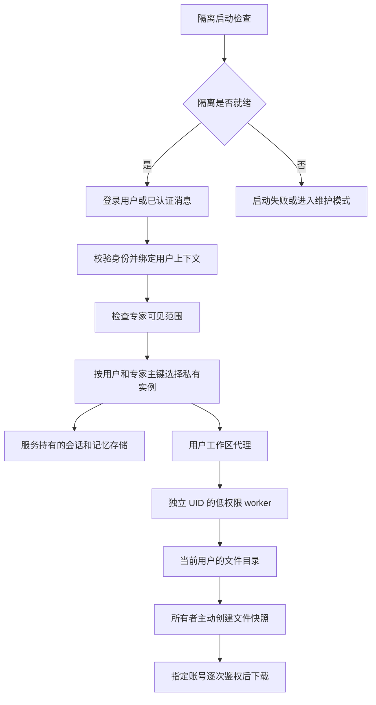

# 隔离机制与 bubblewrap 取舍

作者：chenjixian

## 1. 核心结构

专家定义可以共享；用户的运行内容分别存放。访问控制负责确定使用者及可见专家，私有实例负责选择正确的会话和记忆，低权限 UID 与目录权限负责约束文件及命令实际能访问的内容。

入口和核心实现见 [中间件](../../src/octop/api/middleware/user_isolation.py)、[context.py](../../src/octop/infra/isolation/context.py)、[runtimes.py](../../src/octop/infra/isolation/runtimes.py)、[policy.py](../../src/octop/infra/isolation/policy.py)。

## 2. 三种身份不要混用

| 标识 | 负责什么 | 不代表什么 |
| --- | --- | --- |
| 公开专家 ID 与专家数据库主键 | 专家定义、可见范围和实例来源 | 不自动代表当前聊天用户 |
| Octop `users.id` | 当前使用者；映射为 Linux UID/GID `200000 + users.id` | 不等于 MCN 公司、员工或机构 ID |
| 用户与专家派生的内部实例 ID | 独立工作区、会话、记忆配置和运行缓存 | 不是一个新的平台账号或系统登录账号 |

内部实例键包含用户 ID，以及专家数据库主键和公开 ID 的摘要。纳入不可变主键是为了避免删除后复用公开 ID 时误接旧内容。实例使用单独的异步锁控制首次创建，配置指纹用于决定何时重建；模板初始化有单独标记，避免每次重启覆盖用户内容。

同一平台账号的不同专家使用相同 Linux UID。应用仍按专家分配目录和状态，但用户命令在操作系统权限允许时可以访问该账号其他专家的文件。因此它是按账号的操作系统隔离，不是按专家的操作系统隔离。

同一账号跨公司使用时也仍是同一 UID。MCN 的业务租户和权限必须由其认证、连接器及接口继续控制，不能从文件隔离推导出公司租户隔离。

## 3. 身份如何传递

1. 隔离开关由 `OCTOP_USER_ISOLATION` 决定，默认关闭；`enabled()` 在进程内缓存，避免热修改环境造成接口与执行端采用不同策略。
2. 中间件在 HTTP/WS 生命周期内使用 `actor_scope` 绑定已认证用户。使用 `asyncio.to_thread` 的相关调用沿用上下文，不修改主进程的全局 UID。
3. 网关消息和审批恢复也先绑定使用者；共享专家不能在没有身份时隐式借用创建者。声明的用户与当前身份不一致、线程属于其他用户或其他专家时拒绝执行。
4. `AgentManager` 的普通调用、流式调用和审批恢复选择内部实例；共享定义仍由原有管理入口维护。
5. 文件、记忆、终端等接口从当前使用者选择实例，而非把公开专家 ID 直接当作内容所有者。

这些是代码确认的机制。所有业务入口是否确实遵守该机制，需要相应运行证据；既有证据和未覆盖范围见 [验证说明](03-验证证据与未验证范围.md)。

## 4. 真正的文件执行边界

### 4.1 数据目录分工

以下路径相对于 `OCTOP_HOME`：

| 路径 | 角色 |
| --- | --- |
| `agents/<原专家ID>/` | 原工作区保留，作为受控旧数据来源 |
| `user-workspaces/<用户ID>/<内部实例ID>/` | 用户真实文件，用户目录属于对应 UID/GID，权限为 `0700` |
| `isolated-runtimes/<内部实例ID>/` | 服务持有的会话、记忆等状态，worker 不直接访问 |
| `file-shares/<分享ID>` | 服务持有的分享快照，通过 API 授权下载 |

数据根目录设为 `0711`，允许 worker 穿过路径，但不允许其列出根目录。控制文件和服务侧目录收紧为 `0600`、`0700`；服务和 worker 使用 `umask 077`。启动策略检查并按模式处理默认 ACL，以真实低权限进程探测路径可遍历性，避免 ACL 继承扩大新文件权限，或 worker 无法到达自己的目录。这里已纳入整理期间新增的启动策略，不能继续套用旧版“父目录必须 other+x、默认 ACL 一律拒绝”的结论。

### 4.2 降权与文件代理

启用要求 Linux root 监管进程保留 `CHOWN`、`FOWNER`、`KILL`、`SETGID`、`SETUID`、`SETPCAP`，并安装 util-linux 的 `setpriv`。解释器、worker 代码及其父目录必须由 root 持有且不可被组或其他用户写入，放在专用数据目录之外；运行依赖也必须能被低权限 UID 读取。隔离未就绪时禁止执行用户任务，不能退回 root 执行；启动失败的具体处理见 4.4 节。root 监管进程仍属于必须信任和保护的服务边界。

[IsolationPolicy.command](../../src/octop/infra/isolation/policy.py) 使用 `setpriv` 设置专属 UID/GID，清除附加组、继承能力、ambient 能力和能力边界，并启用 `no_new_privs`。环境变量按白名单生成，不继承管理端数据库密码、JWT 秘密或加载器变量。

[UserWorkerBackend](../../src/octop/infra/isolation/backend.py) 通过 socketpair 和限长、限时 JSON 调用常驻 worker，不暴露 `cwd`、`root_dir`、`_resolve_path` 等可触发主服务本地回读的属性。协议编码使用 [codec.py](../../src/octop/infra/isolation/codec.py)，不使用 pickle。

[worker.py](../../src/octop/infra/isolation/worker.py) 在低权限下进入工作区，检查非 root、无附加组、`NoNewPrivs=1` 以及相关能力集清零；文件操作复用 `HarnessLocalShellBackend`。工作区路径映射是协议语义，最终权限由内核按实际 UID 判断。

命令通过 `/bin/sh -c` 执行，并没有套入 bubblewrap。命令默认超时 120 秒，接口允许的自定义范围为 1 至 600 秒；返回文本截取到 1 MiB。worker 设置 `NOFILE=1024`、`NPROC=256`、`FSIZE=100 MiB`、`CORE=0`，实际限制还受宿主已有硬上限约束。命令结束后尝试回收其进程组，这不等同于 cgroup 对全部后代进程的强制管理，也不是用户总磁盘配额。

### 4.3 终端、MCP 和未适配能力

- 网页终端和本地 stdio MCP 通过同一 UID 降权策略启动；终端会话按内部实例 ID 区分，重连检查创建者。
- stdio MCP 的用户环境在降权后读取。HTTP/SSE MCP 在远端服务执行，远端权限依赖其认证和业务实现；本机 UID 不能替代远端鉴权。
- 宿主浏览器、桌面、手机、桥接、宿主目录浏览、下载目录及插件等未适配入口被拒绝；相关宿主工具、ACP 和团队委派等不按原形态开放。这是能力收缩，不能写成全部功能兼容。

### 4.4 启动修复、维护模式和诊断

整理期间新增的策略使用 `OCTOP_USER_ISOLATION_STARTUP`，默认值为 `repair`，另可选择 `strict`。这项开关没有改变按用户 UID 执行的机制，也不是 bubblewrap 开关。

- `strict`：启动准备失败时重新抛出异常。它并不等于完全只读检查；现有 `MetadataRepair.apply` 仍会设置预期 mode，并可能在受控身份配置中设置 owner。
- `repair`：对受控目标的 owner、mode、默认 ACL 差异记录原元数据，再执行限定修复；仍无法建立边界时进入 `maintenance`，不继续启动用户执行能力。日志记录不等于已经实现自动回滚。
- `pending`、`preparing`、`ready`、`maintenance` 是策略状态。`command` 调用前使用 `require_ready`，只有 `ready` 才允许启动正常用户任务。
- 控制数据已经满足安全条件时，维护模式可保留最小账号登录；否则只提供更有限的健康/维护入口。新中间件拦截其他 API 和 WS，避免 JWT 豁免路径绕过维护门禁。
- `/api/health` 中的进程 `ok` 不足以证明可以执行，需同时检查隔离 `state`、`ready`。`GET /api/health/isolation` 需管理员身份，提供错误、模式、修复数量及登录可用性，不自动重试或切换策略。

这部分按已读取源码记录，尚未运行验证。原报告中的 ACL 拒绝、启动失败及健康检查结果不能直接覆盖新增 `strict/repair` 行为。

## 5. 分享与旧数据

分享从当前用户工作区读取文件，创建服务持有的只读快照；接收者获得的是快照下载权限，原目录权限不变。最多指定 100 个接收账号，单文件上限为 100 MiB；拒绝绝对路径、上级路径、隐藏和系统文件路径。

详情和下载逐次检查创建者/接收人及撤销状态。只有创建者可撤销；撤销阻止后续请求，不能收回已经下载或已经开始传输的副本。原文件后续修改不更新已有快照。

旧数据仅为原所有者从标准 `agents/` 范围复制普通文件；不复制符号链接和硬链接，不自动遍历外部挂载。成功后才写迁移标记，原文件保留。旧共享专家的历史不能可靠归属访客，因而不向每个访客复制。

启用会收紧数据目录权限，并建立新的用户内容目录，因此需要停服和备份后按目标环境操作。回滚要先停止服务和 worker，再关闭隔离开关；新产生的个人内容不会自动合并回旧工作区，所需内容应分别导出。当前文档整理没有执行任何启用、权限迁移或回滚操作。

## 6. 与项目现有 bubblewrap 路径的区别

这里比较的是本地已安装 `octop-harness` 的 `backends/bwrap_shell.py`，不是对所有 bubblewrap 配置的概括。依赖版本或部署方式变化后应重新核对；文件操作背景见 [项目说明](../agent-backend-file-io.md)。

| 维度 | 当前用户隔离模式 | 项目现有 bubblewrap 包装 |
| --- | --- | --- |
| 主要目的 | 按账号区分运行内容和执行权限 | 限制 shell 所见的文件树和部分命名空间 |
| 边界 | 用户 UID/GID、目录权限、应用鉴权 | 新 mount namespace，加 PID、IPC、UTS namespace |
| 文件树 | 仍是所在宿主或容器的文件树，能访问权限允许的路径 | 将配置的 `root_dir` 挂为 `/`，再挂入系统程序及少量配置 |
| 覆盖入口 | 文件工具、命令、终端和本地 MCP 各自有降权适配 | 该 backend 包装 `execute`；普通文件工具不因此进入同一个 bwrap 进程 |
| 多用户运行状态 | 显式选择用户私有实例和记忆 | bwrap 本身不分配平台用户实例，也不负责会话和业务鉴权 |
| 网络与资源 | 没有新增网络 namespace；只有上述局部 rlimit | 当前参数无 `--unshare-net`，也没有用户总 CPU、内存和磁盘配额 |

三个结论需要准确限定：

1. 隔离模式没走 bwrap 的直接证据是 `AgentManager._backend_spec_for_row` 返回自定义 `UserWorkerBackend`，worker 再直接启动 shell。不能只看配置中的 `virtual_mode=False` 就下结论；worker 内的文件 backend 实际使用 `virtual_mode=True`。
2. 当前 `deepagents` 文件 backend 在虚拟模式会解析路径并检查是否仍在根目录内，不能声称普通外部符号链接必然绕过。该检查与 `O_NOFOLLOW` 也不能被夸大为所有路径竞态都已证明安全；低权限进程仍是独立保护层。
3. 现有 bwrap 包装在 `FileNotFoundError` 时回退到普通 shell；bwrap 自身返回非零退出码通常直接作为失败返回。不能把所有启动失败都写成自动降级。bwrap 自身也有降权机制，具体 UID/能力结果应按版本、参数和启动身份检查，不能笼统认定永远保留或永远清空能力。

## 7. 当前为什么暂不叠加

针对共享专家的跨账号内容隔离，现有方案已经具备核心机制。bubblewrap 能进一步减少宿主文件和进程可见性，但不是实现账号隔离的必需步骤，也不会自动补齐真实业务接口的权限验收。

当前选择是先沿用并验收 UID 方案，暂不增加叠加层。这是限定目标下的取舍，不代表任意不可信代码已经被完整沙箱化，或者未来无需继续加固。

如后续明确要求把不可信命令限制在指定文件树、隐藏宿主进程或限制网络，应重新评估相应沙箱策略。组合时至少处理以下问题：

| 问题 | 对当前实现的影响 |
| --- | --- |
| 命名空间创建权限 | 降权后能否创建 user namespace 取决于内核、容器 seccomp 和宿主策略；不能为兼容直接放开特权容器或让用户命令改为 root 执行 |
| 路径和依赖映射 | 当前 `HOME`、技能、认证路径及解释器使用物理绝对路径；工作区改挂成 `/` 后必须统一映射并挂入必要的只读运行时 |
| 全部执行入口 | 只给 `execute` 套 bwrap 不会同时覆盖独立启动的网页终端和本地 MCP，不能宣称所有执行入口都有 namespace 隔离 |
| 挂载和失败策略 | 过宽宿主挂载、透传管理环境或失败回退会削弱预期边界；目标环境不能建立所需隔离时应拒绝执行 |
| 额外隔离目标 | 网络访问、总磁盘、CPU/内存配额需要单独策略，不能由“已经使用 bwrap”推导为已解决 |

官方说明：[bubblewrap 安全模型与限制](https://github.com/containers/bubblewrap/blob/main/README.md)。实际保护由调用参数和运行环境共同决定；本轮没有实现或运行 UID 与 bubblewrap 的组合。
