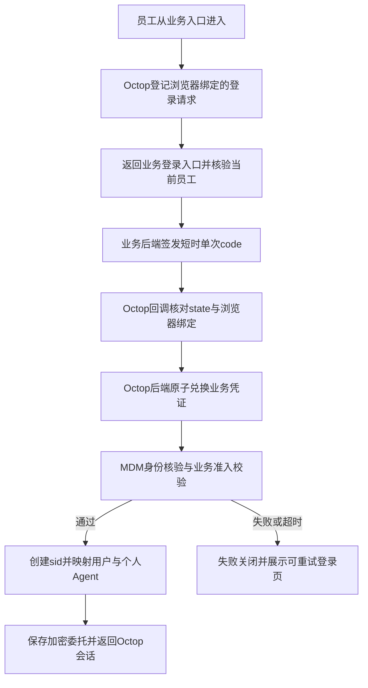
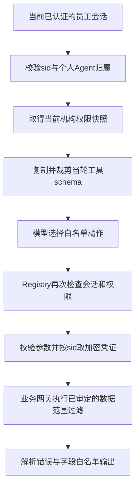

# Octop 对接 MCN 和内容创作平台：接入与实施方案

维护作者：chenjixian

> 状态：代码事实已静态确认，本文为待实现、待测试的方案。内部系统允许停机发版，不以零停机和自动故障接管为验收目标。首期完成个人Agent、会话委托和只读权限闭环；简单、可复用且稳定的能力保留，扩展能力按实际收益、改造成本和稳定性逐项决定，不能因尚未测试就断言消耗大或不稳定。

正文每个方案点均标注现有参考文件与方法；完整仓库路径见第十节。参考表示可复用机制、现有约束或需改动入口，不表示新能力已经存在。拟新增文件在第七节单独标明，不为不存在的文件生成链接。第十一节是本轮对照代码后的审查记录；第十二节是编码前的最终实施口径，与第九节共同优先；第十节仍是路径索引。

## 〇、范围、验收目标与决策

| 项目 | 首期推荐方案 | 实施前置条件 | 参考文件 / 方法 |
| --- | --- | --- | --- |
| 接入架构 | 在 Octop 内新增业务适配层，通过现有 HTTP 接口聚合 MCN 与内容创作；ERP 不承载 MCP 协议和模型提示词。 | 业务侧新增最小 handoff 签发、兑换能力；取消“所有业务后端零改动”的承诺。 | [app.py][code-001]；[manager.py / 工具与中间件组装][code-002]；[UserController.java / passwordLogin/switchCompany][code-003] |
| 登录 | Octop 与 MCN 各自持有会话。员工从已登录的业务页做 handoff。Octop 保存的业务凭证使用专用终端，不复用浏览器当前 `Auth-Token`，也不走密码登录或 `switchCompany`。 | 第十二节是实施口径。专用终端要新增枚举，属公共 starter，改前按公共代码门禁确认。准入按 2.2，不把 verify 成功当成准入通过。 | [auth.py / login/logout][code-004]；[service.py / start_login_for_kind/handle_callback][code-005]；[YouliAuthenticationController.java / verifyToken][code-006]；[TerminalEnum.java][code-144] |
| 委托撤销 | 每次认证创建独立 `sid`，业务凭证按 `sid` 绑定；注销撤销当前会话，禁止按用户重新取另一会话的凭证。 | Octop JWT、续期与执行上下文需要小范围兼容扩展，实际修改公共认证前另行取得明确确认。 | [tokens.py / sign_token][code-007]；[deps.py / maybe_sliding_renew_token][code-008]；[auth.py / login/logout][code-004] |
| 数据隔离 | 优先复用官方“公共模板＋用户私有实例”：每机构员工映射独立用户，从经过清理的模板安装专属业务Agent；员工实例禁止共享或发布。 | 接入层补齐幂等绑定、目录/对象前缀、工具和凭证边界；所有权在挂载、执行、共享状态变更和历史恢复时核验。 | [published_creation.py / install_published_expert][code-112]；[publish.py / 导出白名单][code-113]；[manager.py / 工具与中间件组装][code-002] |
| 首批查询 | 逐项核实权限、入参、返回和副作用后开放白名单；订单详情暂不开放。 | 台账中的候选动作全部默认关闭，未完成契约与反例测试的动作不得注册。 | [OrderServiceImpl.java / 列表权限过滤][code-011]；[AiCreatorController.java / getContentIntelligence][code-012] |
| 部署 | 沿用当前PG控制面的接入基线，不因本次接入切换数据库；允许维护窗口停机，扩容按需评估。 | 本次未回读目标实例配置，实际驱动、部署版本和历史模式需据配置确认。仅可选`history_v2`归档有下述兼容限制，不将其泛化为PG不支持普通聊天历史。 | [server.py / 历史后端装配][code-013]；[config.py][code-014]；[thread_messages.py / ThreadMessageRepo][code-098] |
| Shell 与扩展 | 保留原生业务工具、沙箱和负载均衡方案；execute隔离验收前不启用，轻量稳定的扩展通过验证后可以保留。 | 实时调度、自动迁移、历史后端重写等不是首期硬要求，是否投入以验证出的成本和收益决定。 | [execute_env.py / inject_agent_execute_env][code-015]；[server.py / Cron与主动关怀启动][code-016] |

**Step 0 安全门禁（阻断，未关闭不进入联调）**：① 业务 Agent 的共享、发布、复制必须由服务端硬拦截，不能只写“工具拒绝”；② 业务 token 不得进入 CRM/MDM 日志，`getUserMenu` 的 `linkUrl` 不得带 sign；③ 目标环境 `JwtConfig.secret` 必须确认非源码默认值并按需轮换；④ 密码登录在网关/WAF 限流证据或代码限流落地前保持关闭；⑤ 每员工一个 Agent 的容量基线先确定。以上均为 Step 0 放行条件。

验收入口包括已登录业务员工、换账号员工、多机构员工和 Octop 本地管理员；覆盖免登、退出、续期、凭证失效、机构切换、无权对象和服务故障。保持 MCN 既有业务数据与本地管理员登录行为；不新增 SQL 直连业务库、写业务工具或外部计费抓取。

## 一、当前代码事实与边界

| 代码事实（静态确认） | 对方案的约束 |
| --- | --- |
| [UserController.java / passwordLogin][code-003]只把手机号和密码交给 CRM [AuthUserServiceImpl.java / login][code-118]，请求体里的 `refreshToken` 到不了 MDM；新建的 `UserLoginRo` 默认为 false。经贝登录页和内容创作登录都提交了 `refreshToken: true`，见 [login.vue][code-133]、[llmApi.ts][code-031]。[UserDetailDto.java / terminal][code-119]默认 0。MDM [JwtUtilService.java / generateAccessToken][code-117]的 subject，以及 [AuthUserServiceImpl.java / createToken][code-018]写入 Redis 的 key，都是 `用户名-终端-行业`。[getUserByToken][code-140]要求缓存值与 token 完全相同，所以同一把钥匙只有一个槽。[switchCompany][code-017]经 [refreshV2][code-137]执行 `createToken(..., true)` 并覆盖该槽。[logout][code-129]删除的是 `用户名-终端`，不含行业。 | 交出当前 `Auth-Token` 就是与经贝、内容创作共用这一槽，不是独立凭证。有默认机构时密码登录通常复用原 token，不能写成一定会踢掉其他标签页。切机构会覆盖同槽。退出经贝不保证删到 `用户名-终端-行业` 这把钥匙。实施口径见第九节和第十二节：使用专用终端，不接受共槽。 |
| [verifyToken][code-006]核验 token、`tokenVersion` 和机构员工绑定，并回填 `expiration`、`loginStatus`、`mustChangePassword`。找不到机构客户资料时抛 [COMPANY_EXPIRATION(405)][code-142]，见 [客户资料分支][code-136]；该方法不比较到期日。到期比较在 [BaseController 无参 getCurrentUser][code-019]。`mustChangePassword==1` 的拒绝在网关旧鉴权分支 [AuthResolverImpl][code-120]，业务码是 [708][code-143]；网关走 verifyTokenV2 时没有这段判断。`userExpireDate` 只在 `loginStatus==0` 时检查，而无参方法在 `loginStatus!=1` 时已经拒绝，该分支到不了。[getCurrentUser(false)][code-135]不查机构到期和登录许可，`switchCompany` 用的就是 false。有励 [NEED_LOGIN][code-121] 的业务码是 403，不是 HTTP 401。 | verify 成功不等于准入通过。业务码 405 在 verify 中表示缺少机构客户资料；内容创作异常处理还会把业务码 405 映成 HTTP 405，不能当成机构到期。兑换时 Octop 自己核对到期日、`loginStatus==1` 和强制改密。员工许可到期当前并未被 BaseController 拦住，是否额外拦截见第九节。 |
| [xiaogj-youli-platform-gateway-route.txt / 网关路由表][code-020]没有 `/api/auth/**`；[docker-compose.yml / Compose][code-021]的 MDM 服务名为 `youli-mdm`，容器名为 `youli-mdm-service`。 | MDM 校验走经确认可达的内网地址。Nacos 名、Compose 名不能直接当作跨网络 DNS 已连通的证据；不新增宽泛外网认证路由。 |
| CRM [SysRoleServiceImpl.java / 签名生成][code-022]使用 token 的 MD5并缓存一天，[UserServiceImpl.java / checkSign][code-023]只读、不消费，返回身份信息。 | 不直接复用为 handoff code；它缺少单次消费、短有效期、受众和登录请求绑定，也没有完成业务凭证交接。 |
| Octop [tokens.py / JWT][code-007]没有会话标识；[deps.py / 续期][code-008]重新签发现有字段；[auth.py / logout][code-024]只写审计。 | 新增 `sid` 后必须覆盖签发、校验、续期、注销与工具执行；只加数据库字段或删除用户凭证都不足够。 |
| [OrderServiceImpl.java / 订单列表][code-011]对非超管设置商机、创建人和项目负责人范围，[OrderMapper.xml][code-131]用 OR 接上这三项，并另有 `company_id` 条件。超管判断在 MCN [SuperAdminUtil.java / isSuperAdmin][code-130]，含义是数据角色包含 1，不是内容创作那个类。[getOrderDetail][code-025]按 `orderId` 使用 `selectById`，按 `offerOrderId` 预填的分支同样未见机构或员工范围。 | 列表授权不能证明详情授权。详情的两条入参都保持关闭，补业务层对象授权并用同机构无权、其他机构和合法单据验证后再评估开放。 |
| [dir.py / 工作区][code-009]与[manager.py / 长期记忆命名空间][code-026]以 Agent 为单位。 | 用户映射只解决身份分开，工作区和记忆还必须使用不同 Agent；这是逻辑隔离设计，不宣称物理隔离已验证。 |
| [live.py / 实时事件][code-027]和[manager.py / 用户缓存][code-029]在进程内；[store.py / HistoryStore][code-028]仅说明可选版本化归档的SQLite实现，不能代表当前全部聊天历史。 | 共享PG可承载普通线程数据，但不自动同步进程执行状态、所有工作区或可选本地归档；按实际启用的存储分别评估，不据可选归档推断现有PG历史不能跨节点读取。 |
| 本地当前[server.py][code-013]仅在`history_v2_enabled`开启或归档/required标记存在时初始化实例级`history_v2.sqlite`，该分支要求SQLite控制面；[config.py][code-014]中该开关默认关闭。 | 这是可选归档路径的限制，不证明当前运行实例使用SQLite，也不代表PG普通线程消息不可用。保持现有PG方案；仅在实际启用该归档或迁移已有归档时处理兼容性，不引入无关迁库。 |

**补充代码事实（本轮核对）**：[JwtConfig.java / secret][code-150] 的 `secret` 有硬编码默认值，[JwtUtilService.java / generateAccessToken][code-117] 用它 HS256 签发/校验；仓库内未找到覆盖配置。[SysRoleServiceImpl.java / getUserMenu][code-147] 在 info 级别打印完整 `UserTokenVo`（含 token），并可能生成一天有效的 sign 写入 Redis；[YouliAuthenticationController.java / verifyToken][code-006] 在 token 过期/身份不符时打印 token；[JwtUtilService.java / getUsernameFromToken][code-154] 在 debug 级别打印 token。[OrderController.java / viewOrderDetail][code-148] 与 `getOrderDetail` 一样直接 `selectById`，没有 `company_id`/员工范围校验。[llmApi.ts][code-031] 登录先 `clearAuthToken()`，会清掉同源 MCN 的 `Auth-Token`/`userInfo`。这些都在正文对应位置按“必须修复/默认关闭”处理。

## 二、统一登录与 handoff 协议

### 2.1 来源与信任关系

优先为 Octop 使用与业务系统不同的浏览器源，具体域名待部署确认。来源存储方式参考[llmApi.ts][code-031]和业务登录入口[UserController.java][code-003]。同域不同子路径仍共享 `localStorage` 的来源边界，CSP只能降低脚本风险，不能把 `/aiwork/` 或 `/octop/` 变成安全隔离边界。已有同源入口仅作为兼容部署候选，上线前需确认受控脚本、内容渲染和插件策略。

业务入口与请求方式参考[AppLayout.tsx][code-030]；[llmApi.ts][code-031]。业务前端只在自身登录流程内使用 `Auth-Token`；Octop 前端不读取、存储或转发业务 token。MCN 作为统一 handoff 签发方，内容创作入口也接入同一协议，避免重复实现身份服务。

下表为拟新增协议，路径、请求模型和网关/拦截器放行方式在实现前落到接口契约；不能把拟新增能力写成现有接口。

| 参与方与动作 | 输入与输出 | 必须执行的校验 | 参考文件 / 方法 |
| --- | --- | --- | --- |
| Octop `start` | 创建待登录请求，登记 `request_id`、`state`、受众、固定回调标识及随机兑换证明；浏览器持有绑定该请求的短时、Host-only、Secure、HttpOnly、SameSite=Lax cookie。 | 登记的业务登录来源；固定回调白名单；请求过期与限流。已有有效会话不得被一个外来 code 静默换号；并行登录请求按各自state匹配，不能覆盖为一个全局待登录状态。 | [service.py / start_login_for_kind/handle_callback][code-005]；[pkce.py / new_pkce_pair][code-032]；[sso_cookie.py / set_sso_state_cookie][code-033] |
| 业务侧 `issue` | 当前业务登录态和已登记的登录请求；生成高熵随机 code，建议有效期60秒，并冻结账号、机构、员工、行业和受众。 | 先执行 2.2 同一组准入：`loginStatus==1`、机构 `expiration` 未过、`mustChangePassword!=1`、账号/员工绑定有效；再做 Origin/CSRF 和登录请求真实性校验。回调与受众从服务端配置读取。随机 code 不由业务 token 的哈希派生。 | [SysRoleServiceImpl.java / getUserMenu签名][code-022]；[UserServiceImpl.java / checkSign][code-023]；[YouliAuthenticationController.java / verifyToken][code-006] |
| 浏览器回调 | 顶层导航到 Octop 静态回调页，code 只放 URL fragment；页面立即同源 POST 到 Octop 后端，body 携带 code、state、request_id。禁止把 code 放在 query。 | Octop 后端核对 cookie、state、request_id 与待登录请求，拒绝缺失、过期、串用及重复回调；回调页不加载第三方资源，立即清理 fragment；响应 `Cache-Control: no-store`、`Referrer-Policy: no-referrer`，边缘访问日志不记录 query。 | [auth_oauth.py / OauthStartBody/OauthExchangeBody][code-034]；[sso_cookie.py / set_sso_state_cookie][code-033]；[service.py / start_login_for_kind/handle_callback][code-005] |
| 业务侧 `redeem` | Octop后端通过TLS和登记的应用凭证兑换，提供code、受众、请求标识及兑换证明；业务侧校验通过后调用 `YouliAuthenticationApi.refresh` 生成专用终端 token，仅通过后端响应交给 Octop。 | code只存哈希；通过Redis原子操作或数据库条件更新完成校验与单次消费；先检查调用应用和绑定，再消费。审计不记录code、密码或token原文。 | [YouliAuthenticationApi.java / refresh][code-155]；[sso.py / take_login_state/consume_login_code][code-035]；[UserServiceImpl.java / checkSign][code-023] |
| Octop `exchange` | 取得业务token后直连MDM核验，再执行2.2准入；签发带`sid`的Octop JWT并加密保存委托。 | 核验结果必须与code冻结身份一致；超时、身份变化、重复消费和准入失败均不签发会话。失败后重新发起交接，不恢复已消费code。 | [service.py / start_login_for_kind/handle_callback][code-005]；[YouliAuthenticationController.java / verifyToken][code-006]；[tokens.py / sign_token][code-007] |

**应用登记与回调绑定（拟新增，Step 0 定稿）**：Octop 后端使用独立应用凭证调用业务侧 `register`，提交 `request_id`、受众、固定回调、verifier 摘要和过期时间；业务侧只接受已登记应用并保存。应用凭证单独加密存储、可轮换、可停用，审计不记录 secret。`start` 不能只写一个全局 state cookie：采用签名 cookie 内的 `request_id→state` 映射，或按 request_id 设置独立 cookie 名；cookie path 按实际 `/api/auth` 或 `/aiwork/api/auth` 配置。业务侧 `issue` 和 `redeem` 都要校验应用、受众、request_id 和 verifier 摘要；`issue` 同一 request_id 只允许成功签发一次。

`redeem` 生成专用终端 token 后，若 Octop `exchange` 复核失败，Octop 调用业务侧 `revoke`，业务侧按 `用户名-Octop终端-行业` 删除该 token 并记录失败；revoke 失败进入补偿队列并告警，不能静默留下 token。不能只拒绝签发 Octop JWT 而把业务 token 留在 Redis。业务侧 `issue` 也必须先执行 2.2 准入，不能把不可登录或需改密的账号带进兑换。

兑换证明优先复用[pkce.py / new_pkce_pair][code-032]的随机verifier与S256生成方式；登录状态消费参考[sso.py / take_login_state/consume_login_code][code-035]，HTTP回调参考[sso_cookie.py / set_sso_state_cookie][code-033]。现有cookie只有单个state且路径固定，仍需补本方案的并行请求绑定与子路径适配，不能直接宣称原实现已满足。Octop后端通过已登记应用通道向业务侧登记请求标识、受众、固定回调和证明摘要，verifier保留在Octop待登录记录；浏览器不能自行声明可信受众。业务侧issue只接受已登记请求，redeem再次核对verifier摘要与浏览器已匹配的登录请求。

待登录请求、code、委托分别使用独立有效期。上述 TTL 是推荐参数，需进入配置与测试。回调和认证响应使用 `Cache-Control: no-store`，回调页使用 `Referrer-Policy: no-referrer`。code 不放 query：顶层跳到 Octop 回调页，code 只在 fragment，页面立即 POST 兑换并用 `history.replaceState` 清掉。后端只接受带有该 `request_id` cookie 的兑换；跨站 XHR 带不来 `SameSite=Lax` cookie，直接拒绝。现有 SSO cookie 只有一个 state 且路径固定 `/api/auth`，实施时改成按 `request_id` 分开，路径等于实际回调路径，覆盖 `/aiwork/`。日志不记录 query、fragment、code 和 token。code 消费与本地事务不是跨系统原子：失败不签发 JWT，也不把 code 恢复为可用。兑换出的业务 token 使用第十二节专用终端，不保存浏览器当前 `Auth-Token`。

流程参考：[service.py / start_login_for_kind/handle_callback][code-005]；[YouliAuthenticationController.java / verifyToken][code-006]；[tokens.py / sign_token][code-007]；Youli交接与sid绑定为拟实现能力。

### 2.2 身份有效与业务准入分开核实

| 校验项 | 权威来源与处理 | 参考文件 / 方法 |
| --- | --- | --- |
| 身份完整 | MDM返回的`userId`、`companyId`、`employeeId`必须有效，行业须与交接身份匹配；不接受浏览器提供的身份快照。MDM校验按`YouliAuthenticationApi`的`@RequestBody String`契约对接，单独验证编码和返回结构，不套用业务列表信封。未选机构不能签发正式Octop会话。 | [YouliAuthenticationController.java / verifyToken][code-006]；[BaseController.java / getCurrentUser][code-019] |
| token与账号状态 | 使用MDM在线核验token、`tokenVersion`和账号/员工绑定；另外核实账号可用与在职状态的权威判定。现有返回字段不足以证明某项时，由业务侧补只读准入结果，不假设默认有效。 | [YouliAuthenticationController.java / verifyToken][code-006]；[BaseController.java / getCurrentUser][code-019] |
| 机构有效期 | 用返回的 `expiration` 按业务时区比较，缺少该字段则失败关闭。`verifyToken` 的 405 只在找不到机构客户资料时抛出，不表示到期日已过；到期比较以无参 `getCurrentUser` 为准。内容创作若把业务码 405 变成 HTTP 405，也不能当成到期。 | [YouliAuthenticationController.java / verifyToken][code-006]；[客户资料分支][code-136]；[BaseController.java / getCurrentUser][code-019]；[COMPANY_EXPIRATION][code-142] |
| 登录许可 | 正式兑换对齐无参 `getCurrentUser`：`loginStatus` 必须为 1。`userExpireDate` 分支要求 `loginStatus==0`，因此在这条路径上到不了，当前代码并不拦截员工许可到期。`getCurrentUser(false)` 连机构到期和登录许可都不查，不能把 `switchCompany` 的这个调用当成准入样板。是否另外拦截员工到期，先按第九节确认，不自行增加日期规则。 | [BaseController.java / getCurrentUser][code-019]；[getCurrentUser(false)][code-135] |
| 强制改密 | `mustChangePassword==1` 时必须先到业务系统改密，不能兑换，也不能用本地缓存绕过。`verifyToken` 只回填该字段；真正拒绝在网关旧鉴权分支，业务码 708。直连 verify 或走 verifyTokenV2 时，Octop 必须自己拒绝。 | [YouliAuthenticationController.java / verifyToken][code-006]；[AuthResolverImpl.java][code-120]；[MUST_CHANGE_PASSWORD][code-143] |
| Octop平台状态 | 映射用户已停用或会话被撤销时拒绝进入；不因为上游校验成功而重新启用该用户。 | [manager.py / resolve_or_create_sso_user][code-010]；[deps.py / resolve_user_from_token][code-036] |

### 2.3 换账号、密码登录与切机构

| 场景 | 推荐行为与失败边界 | 参考文件 / 方法 |
| --- | --- | --- |
| 退出Octop | 撤销当前`sid`并清理本地`auth_token`，设置`sessionStorage['octop:manual_logout']='1'`；不调用MCN logout、不修改`Auth-Token`。网络失败时清理本地登录信息并提示服务端撤销尚未确认，不能伪报撤销成功。 | [auth.py / login/logout][code-004]；[AvatarDropdown.tsx / handleLogout][code-037] |
| 退出后进入登录页 | 不自动发起新handoff；由员工主动选择“使用业务账号进入”或“使用其他账号”。新标签页策略也需联调，不能把sessionStorage当作跨标签页注销凭据。 | [AuthGuard.tsx][code-038]；[index.tsx][code-039] |
| 员工B密码登录 | 首期关闭，不作为入口。密码登录控制器直接调用登录，没有验证码、失败计数或锁定；短信登录已禁用。未回读到网关或 WAF 的同等限制前，不能写成已有限流边界。以后若要开放，先补验证码、失败锁定、审计和独立限流，再走 2.2。 | [UserController.java / passwordLogin][code-003]；[auth.py / login/logout][code-004] |
| 前端 Auth-Token 冲突 | MCN 与 AI Creator 同源且共用 `Auth-Token`/`userInfo` key；AI Creator 登录先 `clearAuthToken()`，会清掉 MCN 的本地会话。必须先定统一登录（共用生命周期）或独立域名/存储 key；进入 Octop 时不得再调用 CRM `passwordLogin` 或 `clearAuthToken()`，AI Creator 自身登录若保留，必须与 MCN 明确共用或隔离。 | [llmApi.ts][code-031]；[http.ts][code-152]；[04-系统架构与服务清单.md][code-087] |
| 多机构选择 | 不在 Octop 内选择或切换机构。员工先在经贝/内容创作页面选定机构，handoff 的 `issue` 冻结 `companyId`；Octop 只接受已选机构。未选机构的登录请求不进入 code 兑换。 | [UserController.java / passwordLogin/switchCompany][code-003]；[YouliAuthenticationController.java / verifyToken][code-006] |
| token刷新影响 | 这里只说明经贝/内容创作现有登录行为，不适用于 Octop 委托：密码登录会丢掉客户端 `refreshToken`，有默认机构时通常复用原 token；`switchCompany` 会覆盖调用者所在终端的 token。Octop 不保存浏览器当前 `Auth-Token`，不使用这些路径；第九节改为专用终端。 | [UserController.java / passwordLogin][code-003]；[AuthUserServiceImpl.java / login][code-118]；[refreshV2][code-137]；[JwtUtilService.java / generateAccessToken][code-117] |
| 切换机构 | Octop 不调用 `switchCompany`。员工在业务侧切到新机构后重新 handoff；Octop 为新机构创建新的身份映射和 `sid`，重新加载专属 Agent、权限与历史，不在旧线程内替换 `company_id`。旧机构的委托不得用于新机构。 | [UserController.java / passwordLogin/switchCompany][code-003]；[manager.py / resolve_or_create_sso_user][code-010] |
| 本地管理员 | 复用Octop本地认证；业务侧身份不能创建、绑定或提升为平台`admin`，普通员工默认角色也不得继承管理员权限模板。平台管理员不绑定默认业务凭证。 | [auth.py / login/logout][code-004]；[manager.py / resolve_or_create_sso_user][code-010] |
| 本地管理员数据边界 | `_user_may_access` 对 admin 直接放行，管理员可读业务 Agent 工作区/附件；若不允许，必须单独限制并做反例测试。 | [agent.py][code-104]；[workspace.py][code-103] |
| MCN不可用 | 新登录与业务查询失败关闭，返回维护/上游异常；已有Octop会话只能在未撤销、未到期和已确认的身份故障宽限内使用通用功能，取消“100%不受影响”的承诺。 | [deps.py / resolve_user_from_token][code-036]；[YouliAuthenticationController.java / verifyToken][code-006] |

## 三、委托会话、租户与Agent隔离

### 3.1 会话绑定与撤销

采用独立随机`sid`作为Youli登录会话标识，写入已签名JWT；`delegation_session_id`与`sid`使用同一标识，不同时维护两套可分离的会话编号。浏览器单独提交的`sid`不构成身份凭据。

| 设计对象 | 推荐约束 | 参考文件 / 方法 |
| --- | --- | --- |
| 委托存储（拟新增） | `sid`唯一；记录Octop `user_id`、`account_user_id`、`company_id`、`employee_id`、`industry`、加密业务token、会话状态、业务凭证状态、绝对到期和撤销信息。一个用户允许多份独立会话，禁止只有`user_id`唯一键的凭证仓库。准入及必要初始化成功、本地事务提交后才激活会话并返回JWT；失败记录不得作为有效委托读取。 | [services.py][code-040]；[users.py][code-041] |
| 认证与续期 | 每次 Youli 请求从已验签 JWT 读取 `sid`，检查会话归属、撤销、到期和用户停用。`sid` 绝对到期取 Octop 配置与业务 token 剩余寿命的较小值。业务 token 默认 172800 秒，Octop access token 默认 86400 秒。滑动续期不得延长这个绝对到期。业务 token 失效返回 `AUTH_EXPIRED`，必须重新 handoff。 | [tokens.py / sign_token][code-007]；[deps.py / maybe_sliding_renew_token][code-008]；[JwtConfig.java][code-150]；[config.py][code-014] |
| 工具调用 | 从服务端当前请求注入可信的`user_id`、`sid`和`agent_id`；执行时重新核对会话、租户、员工、Agent归属及凭证状态。没有`sid`时拒绝业务工具，绝不按`user_id`回退取其他会话的token。 | [harness_request.py / build_harness_request][code-042]；[tools.py / _tool_ctx][code-043] |
| 注销 | 按当前`sid`原子标记撤销并停止发起新的业务调用、清除其敏感凭证；保留必要审计。保留在浏览器中的旧JWT也必须被服务端拒绝。已经发出的上游请求可能完成，不能承诺追回已经返回的数据。撤销 sid 不会自动撤销仍被经贝使用的同一 Redis token；经贝切机构或真正刷新则会让这份委托失效。退出经贝当前删的 key 不含行业，不能假设它已经作废 Octop 持有的业务 token。 | [auth.py / login/logout][code-004]；[deps.py / resolve_user_from_token][code-036]；[AuthUserServiceImpl.java / logout][code-129] |
| 重新登录 | 总是生成新`sid`，不恢复旧撤销记录；新会话凭证不会让旧JWT恢复业务访问。当前会话注销默认不撤销其他设备会话，机构/员工停用的批量撤销按第九节定稿。 | [tokens.py / sign_token][code-007]；[auth.py / login/logout][code-004] |
| 重启与恢复 | 服务重启后从数据库恢复会话有效性。暂停、排队、重放和恢复调用都用当前认证重新注入上下文，不能信任checkpoint、模型参数或历史消息里的旧身份。 | [server.py / 历史后端装配][code-013]；[harness_request.py / build_harness_request][code-042] |
| 兼容性 | 保留原有本地管理员及其他认证来源；Youli身份缺少`sid`时要求重新登录。JWT扩展、上下文注入和续期属于公共链路变更，先做引用与兼容调查、获得确认后实施。 | [tokens.py / sign_token][code-007]；[auth.py / login/logout][code-004]；[AGENTS.md][code-044] |

既有SSO用户映射复用[manager.py / UserManager][code-010]及`(sso_provider_id, sso_subject)`唯一约束，subject使用`youli:{companyId}:{employeeId}`。该subject不直接用作目录路径，不按手机号或同名自动合并平台管理员账号。内容创作不使用这个员工 ID：[AppStateService.java / userId][code-127]和[TopicAnalysisStore.java / accessWhere][code-134]取的是 `UserDetailVo.userId`，也就是账号 ID。业务工具只携带当前 `sid` 的业务 token，禁止把 `employeeId` 填进内容创作的 `user_id`。

### 3.2 专属Agent与身份传播

| 入口或状态 | 隔离要求 | 参考文件 / 方法 |
| --- | --- | --- |
| 首次初始化 | 优先调用官方 `install_published_expert`，从受控模板为机构员工创建私有业务助手。映射用户使用专用角色 `youli_employee`，权限在创建时写成固定空集或仅聊天所需的显式清单，不复制可编辑的预置 `user` 角色。`user_has_permission` 读的是用户身上的权限快照，所以以后放宽 `user` 角色不会自动扩大已有员工，但新建员工会吃到当时的角色；专用角色避免这件事。使用不同 `agent_id` 和记忆命名空间，并核实 backend 的 root、prefix 和表命名空间互不越界。绑定键按机构、员工、模板区分，数据库唯一约束加幂等重试。初始化失败不回退共享 Agent。 | [published_creation.py / install_published_expert][code-112]；[manager.py / resolve_or_create_sso_user][code-010]；[permissions.py / user_has_permission][code-153] |
| 挂载与执行 | 仅对启用业务集成且`agent_row.user_id == current_user.id`、`is_shared == false`的专属助手挂载工具，执行层再检查一次；其他人的共享Agent即使有非空owner也必须拒绝。 | [manager.py / 工具与中间件组装][code-002]；[tools.py / _tool_ctx][code-043] |
| 分享、发布与复制 | 只允许独立维护、无员工私有数据的模板源发布。员工业务实例在 `youli_agent_bindings` 中带不可变标记 `youli_business`，守卫以 `agent_id` 为准，不在 `agents` 表另存可编辑标志。创建、PATCH、`install_published_expert`、`publish-expert`、`apply_agent_audience` 和 `set_shared` 只要看见该标记，就拒绝共享、改可见性、发布和复制；安装时忽略客户端传入的 `visibility`/`is_shared`，强制所有者私有。现有 [agent.py / _user_may_access][code-104] 对管理员和共享 Agent 放行，工作区、上传、下载和预览都复用它，附件保存也不使用 `owner_id`。因此不能只改界面。文件、媒体、上传、记忆和业务工具按标记再查一次：必须是当前 `sid` 的所有者；平台管理员不因 `is_admin` 读取这些工作区或记忆。首期不做应急读取。 | [agent.py / _user_may_access][code-145]；[experts.py / install][code-114]；[agents.py / create/patch][code-146]；[attachments.py / save_attachment][code-100]；[manager.py / set_shared][code-096] |
| 可信上下文 | 参照[harness_request.py / 现有请求组装][code-042]与[tools.py / 知识工具读取][code-043]，验证真实harness是否将身份送入`configurable`；所有身份只能由服务端覆盖注入。不能只因存在读取示例就声称全路径安全。 | [harness_request.py / build_harness_request][code-042]；[tools.py / _tool_ctx][code-043] |
| 首期支持范围 | 先支持已完成`sid`传递验证的交互式Dashboard请求；无可信会话的IM、Cron、外部MCP、团队转派与重放入口不开放业务工具。新增入口逐项补鉴权和双用户测试后再开放，不影响既有通用AI能力。 | [harness_request.py / build_harness_request][code-042]；[cron.py / 创建任务入口][code-045]；[protocol.py / TOOLS][code-046] |
| 并发与中间件 | 工具定义不闭包绑定员工token；不修改共享工具实例上的schema或描述，按当轮复制。测试跨员工、跨机构、同员工不同会话、续期和重启，确认上下文不串用。 | [hint.py / _with_enriched_tool_description][code-047]；[harness_request.py / build_harness_request][code-042] |

### 3.3 官方模板＋用户私有实例的复用方案

官方已有模板发布和私有安装机制，本地也存在对应实现；优先复用这条链路。它提供按Agent区分的工作区与记忆，不代表同一共享Agent已经按聊天用户隔离文件；`save_attachment`未以`owner_id`建立附件ACL。参见[published_creation.py / install_published_expert][code-112]、[manager.py / 长期记忆命名空间][code-026]、[attachments.py / save_attachment][code-100]。官方机制说明见[专家API](https://docs.octop.cloud/api/agents)，上游实现参考固定版本[v1.0.3b4 / published_creation.py](https://github.com/TencentCloud/Octop/blob/4022e24ef6c34e9716350872b0e93bfaae7a20c3/src/octop/infra/agents/experts/published_creation.py#L396-L486)；不据此认定目标实例已升级或通过隔离验收。

| 方案点 | 推荐实施与边界 | 参考文件 / 方法 |
| --- | --- | --- |
| 公共模板 | 管理员维护独立模板源，通过`POST /api/agents/{agent_id}/publish-expert`发布经过检查的提示词、技能与专家配置。复用现有导出白名单；上传目录、会话和记忆数据库等被排除，但`USER.md`仍可导出，提示词和技能也可能含敏感内容，因此模板源不得承载真实员工资料、业务结果或凭证，发布前检查实际导出清单和内容。 | [experts.py / publish_agent_expert][code-114]；[publish.py / _EXPORT_ROOT_MD/_is_seedable_path][code-113] |
| 私有安装 | 复用`POST /api/experts/published/{expert_id}/install`及领域函数`install_published_expert`；仅服务端白名单`youli_business_templates`中的模板走业务安装。安装时所有者使用已认证的机构员工映射用户，服务端强制`visibility=owner`、`is_shared=false`，忽略请求体里的`visibility`，并在`youli_agent_bindings`写入不可变`youli_business=1`；backend由服务端限定。它创建新的Agent和工作区，不要求每个用户部署一整套Octop，也不自动要求每个用户一个容器。 | [experts.py / install_published_expert][code-114]；[published_creation.py / install_published_expert][code-112]；[manager.py / create][code-097] |
| 统一入口与绑定 | 员工仍可看到同名“经营分析专家”等入口；接入层以`(company_id, employee_id, published_expert_id)`唯一绑定私有`agent_id`，同时核对Octop `user_id`归属。服务端依据当前会话查绑定；并发首次进入只创建一个实例，失败重试复核已创建实例，不因未完成绑定重复安装，不按名称或前端提交的Agent编号选实例。此自动绑定为拟新增能力，不是官方安装接口现成的幂等保证。 | [published_creation.py / install_published_expert][code-112]；[manager.py / create][code-097]；[services.py][code-040]；拟新增仓储见7.1节 |
| 文件与记忆 | A、B安装同一模板后分别使用自己的Agent；上传、读取、搜索、预览、下载和历史恢复均校验当前实例归属。当前`_user_may_access`对 shared Agent 和管理员放行，`require_agent_workspace`/`require_running_workspace`、`workspace/download`、`media/preview`、聊天`upload`都复用它，附件保存也不使用`owner_id`。因此业务 Agent 必须在共享入口被拒绝，文件、媒体、上传、记忆再做按`youli_business`标记的 defense-in-depth：只允许当前`sid`对应的所有者，平台管理员不因`is_admin`读取。目录/root、对象prefix及记忆命名空间按实际backend隔离，不能挂到同一个可读写数据根；不能只隐藏工作区列表。A的经营数据及其提炼记忆不得出现在B的检索或回答中。 | [agent.py / _user_may_access][code-145]；[workspace.py / require_agent_workspace][code-103]；[uploads.py / upload_attachment][code-099]；[manager.py / 长期记忆命名空间][code-026]；[manager.py / _backend_spec_for_row][code-110] |
| 工具与凭证 | 模板只复用能力定义，不写入员工token。知识库、连接器和MCP按安装者可见范围重新校验；不能从模板维护者复制业务授权。服务端调用领域安装函数时保留HTTP入口现有的backend、知识库及连接器校验，不能绕过。业务工具逐次按当前`sid`取委托，复核实例所有者和机构；模型参数、历史消息或共享工具对象不能保存身份凭证。 | [experts.py / install_published_expert/_validated_session_defaults][code-114]；[published_creation.py / PublishedExpertInstallOptions][code-112]；[harness_request.py / build_harness_request][code-042]；[tools.py / _tool_ctx][code-043]；[crypto.py / encrypt_credentials][code-086] |
| 执行沙箱 | 私有实例仍需第五节的最小目录、环境白名单和执行限制。Docker `sandbox_scope=user`中的用户来自专家所有者，不会按共享专家的当前聊天者切换；bwrap或文件服务器也不会自动补齐这一层授权。沙箱类型按实际需求选择，通过隔离验收再启用execute。 | [docker_spec.py / enrich_docker_backend_spec][code-115]；[manager.py / _prepare_docker_backend][code-116]；[execute_env.py / inject_agent_execute_env][code-015]；[bwrap.py / ensure_bubblewrap][code-072] |
| 模板更新 | 使用现有发布快照和刷新机制维护模板；不得把员工私有实例内容回灌公共模板，也不以覆盖工作区方式强推模板更新。现有实例保持私有文件和记忆，更新是否同步及兼容性单独核实，首期不新增自动升级平台。 | [published_creation.py / refresh_published_expert/install_published_expert][code-112]；[publish.py / export_agent_workspace_to_dir][code-113] |

验收使用高层A和实习生B：同模板安装但`agent_id`、owner、有效存储范围与记忆命名空间不同；A上传经营分析文件并形成记忆后，B通过对话、文件工具、预览/下载地址、已知A的Agent编号及恢复历史均不能读取。除私有实例隔离外，还必须由A自己调用`PATCH is_shared=true`、`publish-expert`、`install visibility=all`，再让B访问`workspace/download`、`media/preview`、聊天`upload`；这些入口必须全部拒绝。平台管理员读取业务工作区和记忆的反例也必须拒绝。并验证跨机构、并发首次安装、失败重试、模板导出无敏感内容，以及模板维护者的知识库/连接器授权和A的`sid`凭证不能被B复用。对应参考为上表各入口；这些是待实施的运行验收，当前仅静态确认复用机制。

## 四、聚合工具、权限与动作台账

### 4.1 工具执行链

模型侧保留`youli_context`、`youli_schema`、`mcn_query`、`creator_query`四个入口，所有`domain/action`从同一Registry生成；工具少不代表已杜绝幻觉，隐藏schema也不能代替执行授权。

执行链参考：[harness_request.py / build_harness_request][code-042]；[hint.py / _with_enriched_tool_description][code-047]；[manager.py / 工具与中间件组装][code-002]；实际业务授权由拟新增Registry完成。

| 执行环节 | 必须落实的约束 | 参考文件 / 方法 |
| --- | --- | --- |
| 功能权限 | 首期只调用 `getUserMenuOpr` 做操作码判断，不把 `getUserMenu` 的菜单树交给模型。这两个方法都会把传入的 `appId` 与该公司全部应用 ID 取并集，`appId=2` 不是权限边界。每个动作登记确切操作码；操作码若在其他应用重复，必须改业务侧按应用精确过滤后才能启用，并用“只属于其他应用的码”做反例。`getUserMenu` 现有实现会 info 打印完整 `UserTokenVo`，还会把一天有效的 sign 拼进 `linkUrl`。接入前先改日志，或新增不打印 token 的查询；返回给模型和工具的结果去掉 `linkUrl` 和 sign。订单数据范围用 [SuperAdminUtil][code-130] 加订单 SQL，不用内容创作的 [CrmDataPermissionService][code-049]。权限服务异常、未知动作或未知权限码均拒绝。 | [MenuAccessController.java / getUserMenu/getUserMenuOperate][code-048]；[SysRoleServiceImpl.java / getUserMenu][code-147]；[SuperAdminUtil.java / isSuperAdmin][code-130] |
| 权限缓存 | 建议最长60秒，键至少包含`sid`、机构、员工、行业和应用/终端；注销、换机构和已知权限变更立即失效。过期后获取失败不延用旧快照。撤权传播时限需业务确认，会话撤销不等待该缓存到期。 | [MenuAccessController.java / getUserMenu/getUserMenuOperate][code-048]；[CrmDataPermissionService.java / isSuperAdmin][code-049] |
| Registry | 每个动作声明固定方法与路径、权限条件、独立Pydantic参数模型、上游参数映射、返回模型、超时和副作用等级。`extra='forbid'`，限制页码、`page_size <= 20`、ID数量和字符串长度；禁止任意URL、SQL及覆盖身份字段。内容创作账号和视频列表必须始终显式传 `page` 与 `pageSize`，不能靠上游缺省。身份字段只从当前 sid 注入，内容创作的 `user_id` 用账号 ID，不用 `employeeId`。 | [feishu_cli.py][code-050]；[models.py / ChatTurnBody][code-051]；[AppStateService.java / getAccounts][code-062]；[getVideos 缺省页大小][code-126] |
| 数据权限 | 逐个核实Controller、Service和SQL，复用已证明正确的过滤。带员工token不自动证明对象授权安全；详情、附件与关联对象分别核查`company_id`和员工范围。订单用 MCN 的数据角色和订单 SQL，内容创作用账号 ID，两套不要互相代替。不得为了接入而在Octop复制一套业务SQL权限规则。 | [OrderServiceImpl.java / 列表权限过滤][code-011]；[OrderServiceImpl.java / getOrderDetail][code-025]；[SuperAdminUtil.java / isSuperAdmin][code-130]；[AppStateService.java / userId][code-127] |
| 调用成本 | 明确每动作上游请求数、查询范围和耗时预算；不自动遍历全量分页、不为每条记录再调详情。订单列表已有逐条补充关联数据的路径，接入前按真实页大小评估。拟新增`client.py`复用异步连接并限制并发；现有SSO同步客户端只参考超时配置，不能直接放进异步工具。 | [OrderServiceImpl.java / enrichOrderVoList][code-089]；[service.py / _http_client][code-090] |
| 失败与重试 | 同时解析 HTTP 状态和各动作实际业务信封，不假设所有响应都有 `code`。有励 `NEED_LOGIN` 的业务码是 403，不是 HTTP 401。[AiCreatorExceptionHandler][code-128]把业务码 403 映成 HTTP 403，把业务码 405 映成 HTTP 405 Method Not Allowed，其他 `YouliBusinessException` 多为 HTTP 200。`ContentStatsController` 不在该 advice 的 `assignableTypes` 中，不能套用同一映射。HTTP 405 不能当成机构过期或空列表。默认不重试；只有已证明无副作用的查询才可有界重试。 | [AiCreatorExceptionHandler.java][code-053]；[业务码映射][code-128]；[YouliCommonExceptionCode.java / NEED_LOGIN][code-121]；[request.ts][code-054] |
| 返回与统计 | 每动作做字段白名单、结果体积上限和截断标志；返回当前机构、查询时刻、源数据时刻、分页及可见范围。内容统计标明快照日期/时间，不把抽样分页求和当全量汇总，不编造总数。 | [ContentStatsService.java / canAccess/report][code-055]；[AiCreatorController.java / getContentIntelligence][code-012] |
| 大结果 | [octop_ui_offload.py / OctopUiOffloadMiddleware][code-056]只识别特定`octop_ui`信封，普通业务JSON不会自动卸载。首期显式裁剪；需要产物时另定`content/artifact`契约、存储、访问权限和前端渲染并测试。 | [octop_ui_offload.py / _offload][code-056] |

错误解析参考[AiCreatorExceptionHandler.java][code-053]，拟在`Octop/src/octop/infra/youli_integration/registry.py`定义业务映射。统一错误包括`AUTH_EXPIRED`、`SESSION_REVOKED`、`PERMISSION_DENIED`、`COMPANY_EXPIRED`、`UPSTREAM_UNAVAILABLE`、`UPSTREAM_ERROR`和参数错误；空列表是成功查询下的空结果。上游错误正文不原样泄露内部地址、凭证或敏感调试数据。

### 4.2 首批候选动作：默认关闭，完成核实后逐项启用

以下只确认了静态入口，菜单码、完整DTO/VO、表字段/索引、真实数据范围、实际耗时及副作用仍需逐项形成证据；没有全部通过不得写“已接入”。

| 系统 | `domain/action` | 接口与代码依据 | 开放条件 |
| --- | --- | --- | --- |
| MCN | `order/list` | `POST /api/mcn/order/list`；[OrderController.java / OrderController][code-057]、[OrderServiceImpl.java / 列表权限][code-011]。 | 确认销售订单菜单/查看权限、分页入参及不同员工范围；不顺带开放详情。 |
| MCN | `customer_opportunity/list` | `POST /api/mcn/customer/opportunity/list`；[CustomerOpportunityController.java / CustomerOpportunityController][code-058]。 | 追踪Service、SQL、租户与本人/下属范围；商机详情尚未完成同等核查，不纳入首批。 |
| MCN | `account_product/list` | `POST /api/mcn/product/list`；[ProductController.java / ProductController][code-059]、[ProductServiceImpl.java / ProductServiceImpl][code-060]。本行若保留，语义是销售产品，不是达人账号。达人账号入口是 [AccountController.java][code-132] 的 `POST /api/mcn/account/list`，需另立动作并默认关闭。 | 不能把 `attribute` 的 `-1、1~8` 写成这个接口的产品类型。[ProductVo][code-122] 的产品类型是 `productType`：1 散投、2 项目；同对象 `attribute` 的注解是 1 自营、2 渠道。[ProductCategoryDo][code-123] 的 `attribute` 注解是 -1 全部账号、1 自营、2 渠道、3 专访、4 征稿、5 冲榜、6 全案。[AccountDo][code-124] 的 `attribute` 是 1 头部到 4 其他。权限码和真实枚举核实前保持关闭；禁止按名称过滤后再报总数。列表循环里会按分类再查父级和规格，启用前把单页上游查询数和耗时写进动作预算，不允许适配器省略分页参数。 |
| 内容创作 | `monitor_account/list` | `GET /api/ai-creator/accounts`；[AiCreatorController.java / AiCreatorController][code-061]、[AppStateService.java / getAccounts][code-062]。 | `getAccounts` 与 `getAccountsPage` 都会做默认分类初始化和部门共享迁移，分页不能去掉写库。五个筛选参数都缺省时走全量 `getAccounts`。Registry 的 `page_size<=20` 约束不住缺省参数，调用仍必须显式传 `page` 和 `pageSize`。先由业务方受控完成并验证这两步不再写库；否则保持关闭或补独立无写入查询，不能由 AI 工具隐式触发。 |
| 内容创作 | `monitor_video/list` | `GET /api/ai-creator/videos`；[AiCreatorController.java / AiCreatorController][code-063]、[getVideos 缺省页大小][code-126]。 | 只查已入库视频，无外部实时抓取。`page` 与 `pageSize` 都缺省时页大小等于总条数，等于一次拉出全部可见视频，因此必须显式传分页。员工有部门时 [visibleAccountIds][code-138] 会调用共享部门迁移；这条路径仍会写库时，沿用账号列表的关闭门槛。 |
| 内容创作 | `topic_radar/list` | `GET /api/ai-creator/topic-radar/analysis-tasks`；[AiCreatorController.java / AiCreatorController][code-064]、[TopicAnalysisStore.java / radarAnalysisTasks][code-065]。 | 获取已有分析任务，映射`tasks`内分页结果。普通员工范围是 `company_id` 加账号 ID（`UserDetailVo.userId`），不是 `employeeId`；数据角色包含 1 时只按机构。不触发分析生成。每一行都会再查内容表，所以适配器必须传 page 和 pageSize，单页不超过 20，并把查询数写进预算；超预算则先改成批量查询再开放。 |
| 内容创作 | `topic_radar/detail` | `GET /api/ai-creator/topic-radar/analysis/{analysisId}`；[AiCreatorController.java / AiCreatorController][code-066]。 | 读取任务对应结果，单独验证对象归属和返回模型；无权ID与其他机构ID不能读取。 |
| 内容创作 | `content_stats/report` | `GET /api/ai-creator/content-stats`；[ContentStatsController.java / ContentStatsController][code-067]、[ContentStatsService.java / ContentStatsService][code-055]。 | 执行层再次核验数据角色包含 1。这里的“数据超管”是 [CrmDataPermissionService.isSuperAdmin][code-049]，不是账号 `admin` 标志。`report` 只读已有快照，不调用 `refresh`；日期缺省时按北京时间的当天查询，没有快照就是空结果，不把查询日写成统计生成时间。该控制器不在内容创作主异常处理器的覆盖名单里，错误映射单独核实。 |

下列入口单独区分，不通过“修路径”自动开放：

| 接口 | 语义与处置 | 参考文件 / 方法 |
| --- | --- | --- |
| `POST /api/mcn/order/orderDetail`、`/viewOrderDetail`、`/viewServiceItem` | 三个入口都关闭，不能只关详情。`getOrderDetail` 的 `orderId` 用 `selectById`，`offerOrderId` 是报价预填。`viewOrderDetail` 和 `viewServiceItem` 也按主键取订单或服务项，未见与列表相同的机构及员工范围。业务层补齐对象授权后，三个入口都要用同机构无权、其他机构和合法单据验证，才能单独评估是否开放。 | [OrderServiceImpl.java / getOrderDetail][code-025]；[OrderController.java / viewOrderDetail][code-148]；[OrderServiceImpl.java / viewServiceItem][code-149] |
| `GET /api/ai-creator/content-intelligence` | 内容列表并附带分析摘要；不是已有分析任务列表，首期不冒充`topic_radar/list`。 | [AiCreatorController.java / getContentIntelligence][code-012] |
| `GET /api/ai-creator/content-intelligence/topic-analysis/{analysisId}` | 内容选题分析详情；与雷达任务详情分别登记语义、归属和返回结构，不混用ID。 | [TopicAnalysisController.java / detail][code-068] |
| `/accounts/{accountId}/fetch`、`/redfox-topics/search`等 | 可能写库、生成内容或调用计费外部服务；不进入首期只读Registry。 | [AiCreatorController.java / searchRedfoxTopic][code-094]；[AiCreatorController.java / fetchAccountContent][code-095] |

## 五、Shell与沙箱启用门槛

业务工具在Octop后端执行，凭证只从当前委托取用；员工分析结果文件时不得把凭证写入工作区、日志或Shell环境。首期业务助手关闭`execute`，需要启用时按下表单独验收。

| 约束 | 推荐实施与证据 | 参考文件 / 方法 |
| --- | --- | --- |
| 环境变量 | `inherit_env=True` 只在 backend 类型为 `local_shell` 时写入，不能套到 Docker 或 bwrap 上。`local_shell` 要显式关闭继承并做环境白名单。Docker 另有 `environment_file` 注入，不能据此认为沙箱里没有宿主密钥。bwrap 是否隔离要单独实测。首期业务助手仍不启用 `execute`。 | [execute_env.py / inject_agent_execute_env][code-015] |
| 目录与网络 | 固定个人局部`root_dir`，禁止宿主根、共享数据根、Docker socket与其他员工目录挂载；明确实际网络可达范围，验证不能通过内网服务绕过业务工具授权。目录隔离不自动等于网络隔离。 | [adapter.py / row_to_backend_spec][code-070]；[dir.py / workspace_dir_from_config][code-009] |
| 启动自检 | 同时核对Linux、局部根、实际backend类型、bwrap可执行性和隔离效果。[bwrap.py / 现有安装逻辑][code-071]是尽力安装，不能证明运行成功；未满足时拒绝`execute`，不能静默回退无沙箱执行。 | [bwrap.py / ensure_bubblewrap][code-072]；[launch.py][code-073] |
| 权限配置 | 优先使用最小权限策略，禁止把`SYS_ADMIN`和`seccomp/AppArmor=unconfined`作为默认安装步骤。Docker或systemd只是部署选项，不单独构成安全证据；具体宿主内核、镜像与限制需实测。 | [adapter.py / row_to_backend_spec][code-070]；[bwrap.py / ensure_bubblewrap][code-072] |
| 资源与失败 | 优先使用目标backend已有的执行时限、输出上限和资源配置；CPU、内存、进程配额按实际支持验证，不为首期另建资源调度平台。`runtime_limits.py`是模型运行参数，不是Shell系统资源隔离实现；失败清理只作用于当前执行。 | [adapter.py / row_to_backend_spec][code-070]；[agent-backend-file-io.md / Docker配置][code-091]；[runtime_limits.py][code-052] |

[bubblewrap官方说明](https://github.com/containers/bubblewrap#sandbox-security)指出隔离强度取决于具体参数；[Docker seccomp文档](https://docs.docker.com/engine/security/seccomp/)说明默认策略与最小权限的关系。启用前需检查实际harness实现和目标部署，不能用安装成功或仅一个文件不可读替代完整隔离验证。

## 六、停机发布、负载均衡与扩展取舍

### 6.1 首期单节点

| 项目 | 实施约束 | 参考文件 / 方法 |
| --- | --- | --- |
| 控制面 | 沿用当前PG部署作为接入基线，不增加改用SQLite或迁移数据库的步骤。PG控制面可承载用户、配置和普通线程消息；Agent记忆后端按既有PG配置解析。`history_v2_enabled`默认关闭，只有启用这个可选版本化归档、或检测到对应归档/required标记时，本地当前代码才检查SQLite控制面。该限制不等于PG普通聊天历史不可用，也不是本次业务接入的必改项；是否采用此可选归档另按实际需求评估。目标实例的有效配置尚未在本轮回读。 | [server.py / 历史后端装配][code-013]；[config.py][code-014]；[backend.py / memory_backend_from_agent_config][code-074]；[thread_messages.py / ThreadMessageRepo][code-098] |
| 历史与工作区 | 沿用各Agent当前有效backend，不要求把内容文件统一迁到本地盘。附件与生成文件按backend读写；PG控制面、Agent记忆/checkpoint、工作区内容、可选history_v2和本地运行目录分开核对。PG控制面不等于文件已存PG，远程工作区也不等于所有运行数据都在远程。 | [resolver.py / resolve_agent_backend_spec][code-105]；[backend.py / memory_backend_from_agent_config][code-074]；[server.py / 历史后端装配][code-013] |
| Agent 容量 | 每员工一个私有 Agent 前，先回读预计员工数、单 Agent 冷启动/内存/工作区基线；至少测 100 与 500 个 Agent 的 boot 时间、内存和磁盘。`AgentManager.boot` 顺序遍历所有未停止 Agent，每 Agent 60 秒超时；没有基线不能把 Step 3 标为通过。超标只能改懒启动或按节点分片；退回共享 Agent 不是选项，除非另立并验证用户级命名空间方案。 | [manager.py / boot][code-081]；[manager.py / create][code-097] |
| 子路径 | 前端[publicUrl.ts / publicUrl][code-076]与[config.ts / API配置][code-077]支持构建base。既有资料记录`/aiwork/`，是否改独立源或其他路径待确认；需核对静态资源、回调、WS、SSE和深链接，不直接照搬代理片段。 | [publicUrl.ts / routerBasename][code-076]；[config.ts / getApiUrl][code-077]；[sso_cookie.py / set_sso_state_cookie][code-033] |
| 发版 | 采用停机发版：公告维护窗口，暂停新请求并结束在途业务调用，停止相关进程，核对并备份控制面、实例归档、工作区、配置与密钥，升级代码和适用迁移，重启检查后恢复入口。超时未结束的对话明确中断，不要求无感续接。 | [launch.py][code-073]；[system_archive.py / create_system_backup/restore_system_backup][code-075]；[migrate.py][code-078] |
| 故障 | 明确恢复时间和可接受数据丢失范围，进行备份恢复演练。单节点故障不能承诺自动续聊或零停机。 | [snapshot.py / snapshot_sqlite_file/restore_sqlite_file][code-079]；[system_archive.py / create_system_backup/restore_system_backup][code-075]；[health.py / health][code-080] |

### 6.2 负载均衡：保留轻量选项，优先定期调整

| 能力 | 推荐方案与取舍 | 验证边界 | 参考文件 / 方法 |
| --- | --- | --- | --- |
| 定期评估与分配 | 作为优先方案保留：按约定周期或出现明显拥塞时查看现有运行数据，人工调整后续新用户/新Agent的节点分配；不先开发自动扩缩容和复杂监控平台。周期按真实使用量确定。 | 固定用户/Agent归属，分配变更不改变正在运行的会话；先证明分配与数据位置一致。不能把“改入口”当作已有用户数据已迁走。 | [manager.py / boot][code-081]；[health.py / health][code-080] |
| 已有用户调整 | 允许在维护窗口停机调整，先列明真实存储：共享PG中的消息/记忆和远程backend中的文件可在权限及命名空间不变时继续复用，不默认全部复制。仅本地运行数据需评估搬迁；只有实际启用history_v2时才评估该实例级归档的拆分/恢复成本，不能把可选功能变成所有节点迁移的必需工作。 | 核对身份、会话、Agent、工作区、记忆/checkpoint和归档一致，原实例不再同时处理迁移对象；恢复演练通过前不执行迁移。 | [server.py / 历史后端装配][code-013]；[system_archive.py / create_system_backup/restore_system_backup][code-075]；[snapshot.py / snapshot_sqlite_file/restore_sqlite_file][code-079] |
| 实时连接分配 | 保留`least_conn`作为轻量候选，不因名称“实时”就删除；它只统计连接数。只有在稳定亲和与状态兼容已验证、实现成本可接受时，才用于新会话分配。 | 同一会话后续请求仍固定所属节点；不把每个请求动态分配到不同机器，不据连接数宣称CPU/推理负载最优。若引入额外状态服务才能成立，可退回定期分配。 | [live.py / TrajectoryLiveBus][code-027]；[config.ts / getApiUrl][code-077] |
| 流式路由 | 保留必要的稳定亲和，覆盖WS/SSE、重连、停止和恢复。亲和信息只决定位置，不承担认证；JWT续期不改变节点归属。 | 目标Nginx版本、Cookie/映射和请求路径需实测；亲和丢失时提示重登/重连或人工恢复，不承诺自动跨节点续聊。 | [live.py / TrajectoryLiveBus][code-027]；[harness_request.py / build_harness_request][code-042] |
| 配置与缓存 | 用户停用、角色和sid撤销仍以权威状态为准；一般模型/Agent配置可以在维护重启时统一加载，不强制新建实时失效总线。若既有轻量重载可满足，则复用。 | Cache-Aside不能发现已经命中的停用用户；必须验证权限变更传播。普通配置允许延迟，安全撤权不能无限延期。 | [manager.py / get/get_by_id][code-029]；[deps.py / resolve_user_from_token][code-036]；[manager.py / 工具与中间件组装][code-002] |
| Agent与后台任务 | 多节点时先做静态归属，节点只启动所属Agent及对应Cron/主动关怀；相关任务配置请求落到其执行节点。已有通用任务可保留，不把所有后台功能整体关闭。 | 当前各节点会加载全部Agent/任务，需补过滤与路由，不能仅加Nginx。节点故障允许人工恢复；自动选主/接管不是必需项。 | [manager.py / boot][code-081]；[manager.py / boot/create][code-082]；[scheduler.py / start_all][code-083] |
| 共享历史与自动迁移 | 作为可选改造保留；如静态归属和停机维护已经满足需要，就不为扩容而先重写HistoryStore。 | 当前PG与版本化历史存在明确兼容限制。是否改造以迁移范围、恢复可靠性和真实收益决定，不能在未测量前声称运行消耗巨大。 | [server.py / 历史后端装配][code-013]；[store.py / HistoryStore][code-028] |
| 自动选主与滚动发布 | 有现成稳定、低成本复用时可以保留为可选能力；内部系统当前按停机发布和人工恢复验收。 | 若需要引入租约、脑裂处理、执行防重、跨节点通知和兼容迁移等较大改造，则延后，不作为首期阻塞。 | [server.py / Cron与主动关怀启动][code-016]；[manager.py / boot/create][code-082]；[launch.py][code-073] |

SQLite WAL不用于跨主机NFS共享，参见[SQLite说明](https://sqlite.org/wal.html)。Nginx的连接分配与健康检查按[实际模块能力](https://nginx.org/en/docs/http/ngx_http_upstream_module.html)核对；上述扩展尚未实现，没有运行数据就不作“稳定、低消耗”或“不稳定、高消耗”的定论。

### 6.3 保留、延后与回退的判断

| 分类 | 判断依据 | 处置 | 参考文件 / 方法 |
| --- | --- | --- | --- |
| 已有且直接适用 | 现有文件和调用链能对应需求，必要验证通过，资源使用可接受。 | 保留并复用，不因简化方案删掉成熟能力。 | [AGENTS.md][code-044] |
| 少量改动即可满足 | 改动范围清楚，权限与状态边界可验证，不需新增复杂基础设施。 | 保留为实施候选，做最小验证后决定启用。 | [AGENTS.md][code-044] |
| 改造面广或实测不稳定 | 需要重写历史/调度等核心，或验证中出现数据不一致、重复执行、明显性能退化且局部方案不能解决。 | 延后该扩展，回退到单节点、固定归属、定期分配和停机维护；不牺牲权限隔离与会话撤销。 | [AGENTS.md][code-044]；[server.py / 历史后端装配][code-013] |

### 6.4 用户文件如何管理：现有代码与接入约束

本节说明代码已有机制，不断言目标实例已启用哪种backend。用户文件以Agent工作区为管理单位，内容读写统一经过`BackendWorkspace`；不为本次业务接入另建一套独立文件服务器。

| 管理点 | 当前实现与推荐处理 | 参考文件 / 方法 |
| --- | --- | --- |
| 文件归属 | 一个用户可以拥有多个Agent，对应多个工作区。同一Agent的不同对话上传到该工作区的`inbound/`，不是自动按每条会话另建独立文件库；文件出现在某个对话里不等于具有独立会话级ACL。 | [uploads.py / upload_attachment][code-099]；[inbound_store.py / write_inbound][code-101] |
| 上传链路 | `POST /api/agents/{agent_id}/upload`先做用户和Agent访问校验，再校验大小/类型，经`save_attachment`与`write_inbound`写入backend；返回工作区路径和预览/下载地址。 | [uploads.py / upload_attachment][code-099]；[attachments.py / save_attachment][code-100]；[inbound_store.py / write_inbound][code-101] |
| 实际存放位置 | 读取Agent配置的`backend`；named引用再查`storage_backends`。适配代码支持filesystem/local_shell、OSS、COS、S3兼容、Postgres、Docker等。是否启用、路径/prefix及存储位置以有效配置为准，不能因控制面是PG就认定文件也在PG。 | [manager.py / _backend_spec_for_row][code-110]；[resolver.py / resolve_agent_backend_spec][code-105]；[adapter.py / row_to_backend_spec][code-070] |
| 默认值与本地目录 | `workspace_dir`是本地运行目录这一维度，不直接证明内容backend是本地。未配置backend时由`default_agent_backend_spec`走harness默认路径；不能据创建了本地目录就覆盖已有远程backend，也不能把默认值当目标实例的配置。 | [resolver.py / default_agent_backend_spec][code-108]；[dir.py / workspace_dir_from_config][code-009]；[manager.py / _backend_spec_for_row][code-110] |
| 浏览与下载 | 工作区API提供列表、上传、读写、移动、删除与下载。预览/下载通常经Octop鉴权后读取backend字节返回；这条聊天附件链路不是浏览器直接向OSS上传。管理接口与共享访问接口的权限须分别看，不能统一概括为只有上传者可访问。 | [workspace.py / 工作区文件接口][code-102]；[attachments.py / dashboard_inbound_preview_url][code-100]；[workspace.py / require_agent_workspace][code-103] |
| 用户与共享权限 | 当前主要按Agent的owner/共享范围/管理员权限判断；`save_attachment`明确不以传入`owner_id`建立独立附件ACL。按3.3节复用公共模板安装个人私有Agent，共享入口解析到当前用户实例，并验证backend目录或对象前缀隔离；禁止把所有用户路由到同一共享Agent后宣称文件私有。 | [published_creation.py / install_published_expert][code-112]；[agent.py / require_agent_row][code-104]；[attachments.py / save_attachment][code-100]；[manager.py / set_shared][code-096] |
| 存储配置权限 | 存储backend有现成可见范围和权限检查，可复用以限制员工能选择的存储；“有权使用某个backend”与“该backend内各员工文件相互隔离”是两种约束，不能互相替代。 | [storage_backends.py / list_storage_backends_for_user][code-106]；[manager.py / _assert_named_storage_backends][code-111] |
| 备份与恢复 | 系统备份代码会处理控制面及本地workspace目录，不可直接声称远程bucket的全部对象也已打包。按实际backend核对PG备份、本地卷备份和对象存储的保留/恢复能力，优先沿用既有机制，不先搬文件或另建服务。 | [system_archive.py / create_system_backup][code-107]；[backend.py / memory_backend_from_agent_config][code-074] |
| 多节点与大文件 | 共享内容backend可减少文件搬迁，但本地运行目录和内存执行状态仍要单独处理。当前上传会读取bytes、下载使用`adownload_bytes`后返回，不能将接口名中的StreamingResponse当作已实现对象存储直传/端到端流式传输。只有真实文件大小和并发产生问题时，再评估直传、缓存或流式优化。 | [uploads.py / upload_attachment][code-099]；[workspace.py / download_file][code-102]；[live.py / TrajectoryLiveBus][code-027] |

## 七、代码改造、数据与兼容边界

以下是未来实现清单，本次只修改本方案。各仓库按各自分支规范工作，不在本次切分支、修改代码、迁移或部署。

| 范围 | 拟新增或扩展位置 | 必须补齐的接线与兼容要求 | 参考文件 / 方法 |
| --- | --- | --- | --- |
| MCN业务侧handoff | CRM新增专用业务Controller、Service及短时code存储；业务入口页接入统一登录请求。 | 签发、兑换、应用鉴权、原子消费、准入及审计完整实现；网络和认证放行只覆盖必要新入口，不暴露MDM通用认证接口。建议类名见7.1，接口DTO按实际契约核对。 | [UserController.java / passwordLogin/switchCompany][code-003]；[SysRoleServiceImpl.java / getUserMenu签名][code-022]；[UserServiceImpl.java / checkSign][code-023] |
| 内容创作入口 | `hh-ai-creator/ai-creator`中的业务入口接入同一handoff协议。 | 不新建第二套签发后端，不修改现有核心权限方法；入口位置按实际页面核实。 | [AppLayout.tsx][code-030]；[navigation.ts][code-084]；[llmApi.ts][code-031] |
| Octop认证适配 | 新增`infra/auth/youli/`，包含客户端、准入、用户映射和会话服务；新增`api/routers/auth_youli.py`。 | `api/app.py`注册路由；`api/deps.py`只精确放行必要的登录入口。退出、正式会话切机构保持sid鉴权；待登录选机构只接受绑定本次已认证账号的短时请求标识，不放宽为匿名切换。复用限流、验证码、错误信封及i18n。 | [app.py][code-001]；[auth.py / login/logout][code-004]；[deps.py / resolve_user_from_token][code-036] |
| Octop公共认证 | `infra/auth/tokens.py`、`api/deps.py`、`api/routers/auth.py`及必要的已认证请求上下文。 | `sid`签发、验证、保留续期、注销与可信注入必须一起完成；保护本地admin、其他认证来源和已有客户端。变更前按公共代码门禁确认。 | [tokens.py / sign_token][code-007]；[deps.py / maybe_sliding_renew_token][code-008]；[harness_request.py / build_harness_request][code-042] |
| 持久化 | 在`infra/db/repos/`新增委托和Agent初始化绑定仓储，在`infra/db/services.py`接入；新增或合入适用的成对SQLite/PG迁移。 | 委托`sid`唯一，索引覆盖用户/机构撤销及过期清理。Agent 初始化绑定的唯一键是 `(company_id, employee_id, published_expert_id)`，并核对 Octop `user_id` 归属；不要收成只按 `user_id`，以免和 3.3 节不一致。绑定记录同时保存不可变 `youli_business=1` 标记，守卫读取该记录，不依赖可变的 `is_shared`。外键、清理与审计生命周期明确。迁移编号遵循当前未发布版本规则，不在方案硬编码。 | [services.py][code-040]；[users.py][code-041]；[migrate.py][code-078] |
| 角色初始化 | `youli_employee`作为独立角色种子写入，权限固定为空或仅聊天显式清单；不复制可编辑的`user`模板，不随模板后续修改扩大已有用户。 | 迁移幂等；新建员工权限快照符合清单；管理员不能把业务员工提升为`admin`。 | [permissions.py][code-153]；[manager.py / resolve_or_create_sso_user][code-010] |
| 业务聚合 | 新增`infra/youli_integration/`中的工具、Registry、权限中间件及MCN/Creator动作；`AgentManager`工具与中间件组装处显式挂载。 | 不只创建文件而遗漏[manager.py / 组装入口][code-002]；基础生命周期保持兼容，按专属Agent启用并复核共享/发布限制。 | [manager.py / 工具与中间件组装][code-002]；[hint.py / _with_enriched_tool_description][code-047] |
| 业务 Agent 守卫 | 新增`infra/agents/business_guard.py`（或`youli_agent_bindings`仓储查询方法）提供`is_business_agent`/`require_business_agent_owner`；在`AgentManager.set_shared`、`agents.py` create/patch、`experts.py` install/publish、`apply_agent_audience`、`workspace.py`/`uploads.py`的共享入口调用。 | 不能只改工具层；业务绑定以`youli_agent_bindings.agent_id`为准；修改公共`AgentManager`/workspace前按公共代码门禁确认。 | [agents.py][code-146]；[experts.py][code-114]；[workspace.py][code-103]；[manager.py][code-096] |
| 安全日志与密钥 | 修改`SysRoleServiceImpl.getUserMenu`、`YouliAuthenticationController.verifyToken`、`JwtUtilService.getUsernameFromToken`的日志，掩码/移除 token；`getUserMenu`返回剥离`linkUrl`；部署前确认`JwtConfig.secret`非默认值。 | 日志脱敏与 secret 覆盖是 Step 0 阻断。 | [SysRoleServiceImpl.java][code-147]；[JwtConfig.java][code-150]；[JwtUtilService.java][code-154] |
| 应用登记与登录请求 | Octop 侧 `youli_login_requests.py`保存`request_id`、state、受众、verifier 摘要、浏览器 cookie 绑定、过期和消费状态；CRM 侧 `YouliSsoController`提供`register/issue/redeem/revoke`契约，并落 `youli_oauth_client`/`youli_auth_code`。 | 应用凭证单独加密、可轮换/停用；两侧表加唯一约束和过期清理索引；CRM register 记录用 request_id 关联 Octop 请求，不复制 token。 | [sso.py / take_login_state/consume_login_code][code-035]；[sso_cookie.py][code-033] |
| 执行上下文 | Dashboard请求组装、harness适配及可恢复调用的必要连接点。 | 新增可信`sid`传递，工具执行验证真实上下文；缺失即拒绝。队列、重放、外部MCP和团队路径逐项调查，首期未通过的入口不接入业务工具。 | [harness_request.py / build_harness_request][code-042]；[tools.py / _tool_ctx][code-043] |
| 前端 | `AuthGuard.tsx`、`AvatarDropdown.tsx`、`pages/Login/index.tsx`及机构/会话展示。 | 使用标准API模块；不读业务token，处理回调、明确退出、换号、多机构待登录、刷新影响和撤销失败；同时处理 MCN/AI Creator 同源`Auth-Token`共用：AI Creator `clearAuthToken()`不得清掉 MCN 会话，或明确改为统一登录/独立 key；共享组件改动按门禁先确认。 | [AuthGuard.tsx][code-038]；[AvatarDropdown.tsx / handleLogout][code-037]；[llmApi.ts][code-031]；[http.ts][code-152] |
| 安全与部署 | 业务助手backend模板、执行环境白名单、自检；部署参考Octop自身Compose与业务侧入口配置，需要多节点时再补静态归属与定期分配。 | execute通过隔离验证后可启用。发布采用停机流程；新域名、端口、路径或部署配置真正变更时同步工作区`docs/04`、`docs/05`；不把计划参数写成真实部署。 | [execute_env.py / inject_agent_execute_env][code-015]；[docker-compose.yml / Octop部署][code-092]；[05-发布与部署.md][code-085] |

凭证加密参考[crypto.py / encrypt_credentials][code-086]，持久化接线参考[services.py][code-040]。业务凭证复用Octop现有加密机制并使用独立用途标识，数据库备份按敏感数据管理；密钥轮换和恢复需验证。MCN/AI Creator业务库不因查询工具新增写入或索引，现有查询索引与数据量是否满足仍需核实；若需数据库优化，单独提供直接可执行SQL、账号、回滚和审批。

兼容与授权规则参考[AGENTS.md][code-044]及[工作区AGENTS.md][code-093]。实际修改公共认证、`AgentManager`、共享前端组件或其他高频代码前，必须用`rg`核对引用数、主要调用方、局部替代方案及兼容风险，再按工作区规则取得明确确认。方案认可不自动等同于代码修改、推送、数据库写入或部署授权。不把权限过滤塞进 `xiaogj-youli-common-starter`。专用终端枚举是登录 key 的必要扩展，仍属公共代码，未按门禁确认就不改、也不发版。

外部MCP延后：[protocol.py / 现有协议][code-046]暴露专家列表、调用与恢复，会经过专家执行，并不直接暴露这四个业务工具。未来如需直接业务MCP，应另定义按用户和委托认证的`tools/list/tools/call`契约；本期不承诺现成可用。

### 7.1 拟新增文件与现有扩展点

下列为建议文件名，尚未创建；实现时按仓库分层落地。协议与字段模型跟随相关模块，不另造基础认证框架。

| 责任 | 拟新增文件（工作区相对路径） | 现有参考与扩展位置 |
| --- | --- | --- |
| 业务侧handoff | `huihuo-mcn/src/xiaogj-youli-crm/xiaogj-youli-crm-service/src/main/java/com/xiaogj/youli/crm/api/controller/YouliSsoController.java`；同模块`app/crm/service/YouliSsoService.java`及`app/crm/service/impl/YouliSsoServiceImpl.java`。 | [UserController.java / passwordLogin/switchCompany][code-003]；[SysRoleServiceImpl.java / getUserMenu签名][code-022]；[UserServiceImpl.java / checkSign][code-023] |
| 应用登记与登录请求 | Octop 侧 `youli_login_requests.py`；CRM 侧 `YouliSsoController` 提供 `register/issue/redeem/revoke`，并新增 `youli_oauth_client`/`youli_auth_code` 迁移。服务端白名单 `youli_business_templates`。应用凭证只存哈希，可轮换和停用；请求表保存 request_id、state、受众、verifier 摘要、浏览器绑定、过期和消费状态，并加唯一约束。 | [sso.py / take_login_state/consume_login_code][code-035]；[sso_cookie.py][code-033]；[services.py][code-040] |
| Octop认证与委托 | `Octop/src/octop/infra/auth/youli/client.py`、`service.py`、`session_store.py`；`Octop/src/octop/api/routers/auth_youli.py`。 | [service.py / start_login_for_kind/handle_callback][code-005]；[tokens.py / sign_token][code-007]；[deps.py / resolve_user_from_token][code-036] |
| 会话与Agent绑定仓储 | `Octop/src/octop/infra/db/repos/youli_sessions.py`、`youli_agent_bindings.py`；后者保存机构、员工、映射用户、官方模板ID及私有Agent绑定，落实3.3节唯一约束与并发幂等。安装复用官方领域函数，不另写模板复制器；若现有SSO状态表不能满足浏览器绑定与受众契约，再新增`youli_login_requests.py`。 | [published_creation.py / install_published_expert][code-112]；[experts.py / 安装准入校验][code-114]；[users.py][code-041]；[services.py][code-040] |
| 工具与权限 | `Octop/src/octop/infra/youli_integration/tools.py`、`middleware.py`、`registry.py`、`mcn_actions.py`、`creator_actions.py`。 | [manager.py / 工具与中间件组装][code-002]；[hint.py / _with_enriched_tool_description][code-047]；[feishu_cli.py][code-050] |
| 数据迁移 | Octop 侧 `Octop/src/octop/infra/db/migrations/`内当前适用版本的成对`.sql`、`.pg.sql`，包含 `youli_login_requests`、`youli_agent_bindings`、`youli_business_templates`；CRM 侧按工作区规范在 `huihuo-mcn/DB/` 新增 `youli_oauth_client`、`youli_auth_code`。编号先核实当前 schema 版本，不编造已落地脚本。 | [migrate.py][code-078]；[AGENTS.md][code-044] |
| 可选部署调整 | 复用现有Compose与Nginx配置；若节点分配需要新文件，实施前在相应部署目录明确其路径，不先承诺已支持自动均衡。 | [docker-compose.yml / Octop部署][code-092]；[04-系统架构与服务清单.md][code-087] |

## 八、分阶段验收与审查项对应关系

### 8.1 实施阶段

| 阶段 | 必须交付 | 放行证据 | 参考文件 / 方法 |
| --- | --- | --- | --- |
| Step 0：准入定稿 | 第十二节的契约、专用终端门禁、JWT secret 回读、注销 key 修正、权限日志脱敏、操作码是否跨应用重复、100 与 500 个私有 Agent 的启动预算。 | 未知权限码、未闭合的 code/token 交接、默认 secret、注销仍删错 key，都不能以“实现时再说”放行。 | [JwtConfig.java][code-150]；[AuthUserServiceImpl.java / logout][code-129]；[MenuAccessController.java / getUserMenu/getUserMenuOperate][code-048]；[AGENTS.md][code-044] |
| Step 1：登录与委托 | 业务侧handoff、Octop准入、`sid`签发/续期/撤销；复用官方模板安装私有Agent，完成机构员工模板绑定和幂等初始化。 | 实测：经贝 PC token 在 Octop 登录后仍可用；Octop 专用终端 token 与经贝 token 的 Redis key 不同；业务侧切机构后旧 Octop 委托失效；退出经贝不误删 Octop 专用终端；logout 按完整 `用户名-终端-行业` 精确删除，改密/停用清掉该账号全部终端；verify 的 405 与到期日不是一回事；`mustChangePassword` 在直连 verify 时仍被拒绝。本地 admin 回归通过。 | [service.py / start_login_for_kind/handle_callback][code-005]；[tokens.py / sign_token][code-007]；[published_creation.py / install_published_expert][code-112]；[AuthUserServiceImpl.java / logout][code-129] |
| Step 2：只读工具 | 四个入口、显式挂载、可信上下文、Registry和逐动作契约；补齐私有实例的文件、记忆、工具和凭证边界。 | 双用户/双机构并发、同用户双会话、无权对象、缺失sid、隐藏动作、HTTP200业务失败、分页/体积限制、无外部计费及无隐式写入验证；3.3节A/B文件与记忆隔离、连接器和凭证反例通过；另加 A 直接 `PATCH is_shared=true`、`publish-expert`、`install visibility=all` 后 B 仍不可读的反例。 | [manager.py / 工具与中间件组装][code-002]；[attachments.py / save_attachment][code-100]；[published_creation.py / install_published_expert][code-112]；[OrderServiceImpl.java / 列表权限过滤][code-011] |
| Step 3：单节点联调 | 登录入口、回调、退出换号、机构提示、持久化和维护发布。 | 使用原业务路径联调：多标签页/并行登录、断线重连、续期、回调 fragment+POST、`/aiwork/` 子路径；Octop 刷新不影响经贝/内容创作标签页；AI Creator 登录/退出不清 MCN 的 `Auth-Token`；重启与备份恢复；目标环境回读会话和实际结果。 | [AuthGuard.tsx][code-038]；[AvatarDropdown.tsx / handleLogout][code-037]；[llmApi.ts][code-031]；[server.py / 历史后端装配][code-013] |
| Step 4：可选Shell | 最小权限backend、环境白名单、真实隔离和资源限制。 | 隔离反例及失效关闭通过后才启用execute；目标Linux/Docker环境实测，macOS上的静态阅读不代替证明。 | [bwrap.py / ensure_bubblewrap][code-072]；[execute_env.py / inject_agent_execute_env][code-015] |
| Step 5：按需扩容 | 优先静态归属、定期分配和停机调整；轻量实时连接分配、共享历史与自动化按成本及稳定性逐项评估。 | 只对启用的能力执行跨实例、归属与恢复验证；自动接管、在线迁移和零停机不列为必验目标。 | [server.py / 历史后端装配][code-013]；[manager.py / boot][code-081]；[manager.py / boot/create][code-082] |

验证规范参考[AGENTS.md][code-044]。代码实施后按仓库要求执行直接相关测试与检查：Octop使用`uv run pytest`并在交付前运行适用的`make all`；前端另核对类型、构建和关键页面。Java构建与环境联调按各仓库授权规则执行。测试必须有业务断言、实际执行且未skip；仅命令成功、Mock返回200或启动完成不算业务验收。本次文档修改不运行应用测试。

### 8.2 问题、推荐方案与验收映射

| 审查项 | 正文落点 | 关键反例或检查 | 当前状态 | 参考文件 / 方法 |
| --- | --- | --- | --- | --- |
| R01 订单详情对象权限 | 一、四.2、十二 | orderDetail、viewOrderDetail、viewServiceItem 都不注册；同机构无权、其他机构和合法单据三组反例通过后才能单独评估。 | 静态确认三个入口都缺对象范围；运行未验证。 | [OrderServiceImpl.java / getOrderDetail][code-025]；[OrderController.java / viewOrderDetail][code-148]；[OrderServiceImpl.java / viewServiceItem][code-149] |
| R02 MDM准入遗漏 | 二.2、十一 | 有效 token 但 `loginStatus` 不是 1、机构到期日已过、需改密，都不能兑换。verify 的业务码 405 只表示缺少机构客户资料。`userExpireDate` 分支当前不可达，未确认前不另加规则。 | 分支已按代码修订；运行未验证。 | [YouliAuthenticationController.java / verifyToken][code-006]；[BaseController.java / getCurrentUser][code-019]；[AuthResolverImpl.java][code-120] |
| R03 handoff与零改动冲突 | 二.1、七 | 单次消费、TTL、受众、浏览器请求绑定、服务端凭证交接。 | 已纳入业务侧必要改造；协议未实现。 | [SysRoleServiceImpl.java / getUserMenu签名][code-022]；[UserServiceImpl.java / checkSign][code-023]；[sso.py / take_login_state/consume_login_code][code-035] |
| R04 委托撤销复活 | 三.1 | 旧JWT注销后即使重新登录也不能使用新委托；双会话独立。 | 推荐sid绑定已写入方案；公共链路未修改。 | [tokens.py / sign_token][code-007]；[deps.py / maybe_sliding_renew_token][code-008]；[auth.py / login/logout][code-004] |
| R05 沙箱环境与权限 | 五 | 敏感环境/外部目录/内网越权不可访问；沙箱失败拒绝执行。 | 现状静态确认；首期execute关闭，隔离未实测。 | [execute_env.py / inject_agent_execute_env][code-015]；[bwrap.py / ensure_bubblewrap][code-072] |
| R06 路由与历史连续性 | 六 | 固定归属下续期、重连、停止、恢复正确；停机迁移或人工恢复后历史一致，不要求自动无缝漂移。 | 首期单节点；集群能力未实现。 | [server.py / 历史后端装配][code-013]；[store.py / HistoryStore][code-028]；[live.py / TrajectoryLiveBus][code-027] |
| R07 缓存与配置失效 | 六.2 | 已缓存用户跨节点停用、降权及时生效；一般配置在维护重启后保持一致。 | 未实现；不能以回源未命中测试替代。 | [manager.py / get/get_by_id][code-029]；[manager.py / 工具与中间件组装][code-002] |
| R08 调度重复与归属 | 六.2 | 静态执行归属、任务配置路由、Cron/主动关怀不重复；节点停机后可人工恢复。 | 必要防重保留；自动选主/接管可选，无现成开关承诺。 | [manager.py / boot/create][code-082]；[cron.py / 创建任务入口][code-045]；[scheduler.py / start_all][code-083] |
| R09 文档口径冲突 | 全文 | 架构、流程、范围、清单和验收采用同一套方案。 | 文档核对；不代表功能已验收。 | [mcn-creator-integration-plan.md][code-088]；[AGENTS.md][code-044] |
| R10 路径与接口语义 | 四.2 | 内容列表/任务列表/不同分析详情不混用；逐项DTO/返回/权限验证。 | 入口静态确认，其余按动作核实后放行。 | [AiCreatorController.java / getContentIntelligence][code-012]；[TopicAnalysisController.java / detail][code-068]；[ContentStatsService.java / canAccess/report][code-055] |
| R11 接线与复用边界 | 四.1、七 | 工具实际挂载、迁移初始化、重启后委托、大结果与MCP边界。 | 实施清单已补齐；接线与契约未验证。 | [manager.py / 工具与中间件组装][code-002]；[services.py][code-040]；[octop_ui_offload.py / _offload][code-056] |
| R12 停机发布与扩展取舍 | 六、八.1 | 停机、备份、适用迁移、重启检查和失败回滚；扩展成本与稳定性有证据。 | 已按内部系统允许停机定稿；扩展按需保留，不要求零停机。 | [launch.py][code-073]；[system_archive.py / create_system_backup/restore_system_backup][code-075]；[migrate.py][code-078] |
| R13 业务 token 专用终端 | 一、二.1、二.3、九、十一、十二 | 经贝/内容创作仍共用 `用户名-终端-行业` 槽；Octop 使用新增专用终端，不覆盖该槽。切换机构、退出经贝、改密和停用要分别验证。 | 方案已定为专用终端；枚举、注销 key 修正和运行验证未完成。 | [TerminalEnum.java][code-144]；[JwtUtilService.java / generateAccessToken][code-117]；[AuthUserServiceImpl.java / logout][code-129] |
| R14 准入分支误读 | 二.2、十一 | 到期日、缺少客户资料、强制改密、员工许可到期四条分开测。HTTP 405 不是机构过期。 | 已按代码修订口径；兑换实现未验证。 | [verifyToken 客户资料分支][code-136]；[BaseController.java / getCurrentUser][code-019]；[业务码映射][code-128] |
| R15 产品字段张冠李戴 | 四.2、十一 | `product/list` 不用 `-1、1~8` 当产品类型。达人账号不走该接口。 | 动作保持关闭，待字段核实。 | [ProductVo.java][code-122]；[ProductCategoryDo.java][code-123]；[AccountDo.java][code-124]；[AccountController.java][code-132] |
| R16 内容列表缺省即全量或写库 | 四.1、四.2、十一 | 账号列表无论是否分页都会做分类初始化和部门共享迁移；五个筛选参数都缺省时还返回全量。视频列表在 `page` 与 `pageSize` 都缺省时页大小等于总条数。 | 已要求显式分页。写库未消除前，账号列表以及会走进迁移的视频列表保持关闭。 | [AppStateService.java / getAccounts][code-062]；[getVideos 缺省页大小][code-126]；[visibleAccountIds][code-138] |
| R17 账号 ID 与员工 ID | 三.1、四.1、十一 | 用员工 ID 查询内容创作绑定或选题任务应为空或错范围，不能因此放行。 | 已要求只携带 sid 对应 token。运行未验证。 | [AppStateService.java / userId][code-127]；[TopicAnalysisStore.java / accessWhere][code-134] |
| R18 业务 Agent 共享/发布/文件越权 | 三.2、三.3、十二 | A 直接 PATCH `is_shared=true`、publish、install `visibility=all` 全部失败；B 读 A 的 workspace/media/upload/memory 全部失败；admin 读业务数据失败。 | 方案已补守卫点；代码未改。 | [agents.py][code-146]；[experts.py][code-114]；[agent.py][code-145]；[workspace.py][code-103] |
| R19 业务 token 日志与 sign | 一、四.1、十二 | `getUserMenu`/`verifyToken`/`getUsernameFromToken` 日志不含 token；`linkUrl` 无 sign。 | 未实现；接入前阻断。 | [SysRoleServiceImpl.java][code-147]；[JwtUtilService.java][code-154] |
| R20 MDM 签名密钥 | 一、八.1、九、十二 | 目标实例 `JwtConfig.secret` 已覆盖且非源码默认；轮换后旧 token 失效。 | 未回读目标配置。 | [JwtConfig.java][code-150]；[JwtUtilService.java / generateAccessToken][code-117] |
| R21 每员工 Agent 容量 | 六.1、八.1、十二 | 100/500 个 Agent 的 boot 时间、内存、工作区磁盘有实测数据；超标改懒启动/分片。 | 未测；Step 3 不得直接通过。 | [manager.py / boot][code-081]；[manager.py / create][code-097] |
| R22 Auth-Token 同源冲突 | 二.3、七、十二 | AI Creator 登录不清 MCN 会话；或明确统一登录/独立 key；跨系统多标签页测试通过。 | 未实现。 | [llmApi.ts][code-031]；[http.ts][code-152]；[04-系统架构与服务清单.md][code-087] |
| R23 handoff 回调与应用凭证 | 二.1、七.1、十二 | register/issue/redeem/revoke 契约、code fragment+POST、request_id cookie、应用凭证轮换、单次签发/消费。 | 未实现。 | [sso.py / take_login_state/consume_login_code][code-035]；[sso_cookie.py][code-033] |
| R24 权限并集与逐行查询 | 四.1、四.2、十二 | `getUserMenuOpr` 跨应用操作码反例；`topic_radar/list` 每页查询数、产品列表逐行查询数写入预算。 | 未验证。 | [SysRoleServiceImpl.java][code-147]；[TopicAnalysisStore.java][code-065]；[ProductServiceImpl.java][code-060] |

## 九、上线前必须确认的策略

这些是方案中明确保留的业务/部署决策，不在文档修改时默认为已获同意；未确认前不启用依赖它们的生产能力。

| 决策项 | 推荐口径 | 未确认时的处理 | 参考文件 / 方法 |
| --- | --- | --- | --- |
| 员工停用、离职与机构失效 | 权威停用触发该机构员工全部sid撤销；通用AI、历史和文件访问的撤销时限明确，身份故障宽限和绝对会话有效期不得被滑动续期无限延长。 | 先定撤销事件/轮询来源及允许时限，作为上线阻塞；不把MCN停用自动等同于Octop已撤权。 | [YouliAuthenticationController.java / verifyToken][code-006]；[manager.py / resolve_or_create_sso_user][code-010]；[deps.py / resolve_user_from_token][code-036] |
| 注销范围 | 默认仅当前sid；独立的“全部设备注销”和组织停用按明确管理策略撤销多会话。 | 不提供伪称“当前会话注销”的user_id级删除方案。 | [auth.py / login/logout][code-004]；[tokens.py / sign_token][code-007] |
| 业务凭证 | 定为专用终端，不接受共槽。业务侧 `redeem` 调用 `YouliAuthenticationApi.refresh`，把 `UserDetailVo.terminal` 设成新增的 Octop 终端；服务端 `refreshV2` 再走 `createToken`，只覆盖 `用户名-Octop终端-行业`。不保存浏览器当前 `Auth-Token`，不调用密码登录和 `switchCompany`。`TerminalEnum` 的 0 到 9 已占用，新增值放在公共 starter，改前按门禁确认。修正注销：当前终端按完整的 `用户名-终端-行业` 精确删除，不能再删 `用户名-终端`；改密、批量重置、停用继续删除该账号全部终端（含 Octop 专用终端），不能只删一个三元组。Octop 撤销 `sid` 时只删自己的终端。 | 枚举未确认或注销 key 未修正，不发版。目标环境若仍用源码里的 JWT 默认 secret，同样不发版。 | [TerminalEnum.java][code-144]；[YouliAuthenticationApi.java / refresh][code-155]；[refreshV2][code-137]；[AuthUserServiceImpl.java / logout][code-129]；[JwtConfig.java][code-150] |
| 密码登录与切机构 | 两条都不作为 Octop 入口。密码登录会丢掉客户端 `refreshToken`，且没有验证码和失败锁定。`switchCompany` 会覆盖调用者所在终端的 token。内容创作现有登录会先清掉浏览器里的 `Auth-Token`，经贝读的是同一个 key；同源部署下这会清掉经贝页面的登录态。进入 Octop 只从已经登录的业务页发 handoff，内容创作不再为 Octop 调用 `passwordLogin` 或 `clearAuthToken`。 | 发版前用同一浏览器实测：经贝已登录时从内容创作进入 Octop，经贝标签页的 `Auth-Token` 仍在；Octop 委托与经贝 PC token 的 Redis key 不同。 | [llmApi.ts / clearAuthToken][code-151]；[http.ts][code-152]；[UserController.java / passwordLogin][code-003] |
| 员工许可到期 | 首期对齐无参 `getCurrentUser` 的实际效果：只拦截 `loginStatus` 不是 1、机构 `expiration` 已过、以及 `mustChangePassword==1`。不额外实现 `userExpireDate`，因为该分支在现有代码里到不了。以后要拦员工到期，另开需求。 | 按这三条做兑换反例，不把 verify 的 405 当成到期。 | [BaseController.java / getCurrentUser][code-019]；[AuthResolverImpl.java][code-120] |
| 部署来源与网络 | 优先独立浏览器源；确认Octop到CRM兑换入口、MDM和业务网关的可达地址、TLS与应用凭证。 | 不假定Compose服务名跨网络可达，不新增未经确认的域名、端口和路由。 | [docker-compose.yml / youli-mdm服务][code-021]；[xiaogj-youli-platform-gateway-route.txt][code-020]；[04-系统架构与服务清单.md][code-087] |
| 权限缓存与容量 | 明确功能撤权可接受延迟、会话撤销实时检查、每用户并发/超时与查询规模；先用代表性请求验证，只有实际出现容量问题时再扩大压测。 | 默认关闭未定动作，不承诺固定吞吐、耗时或“单机无法承载全员”。 | [MenuAccessController.java / getUserMenu/getUserMenuOperate][code-048]；[manager.py / get/get_by_id][code-029]；[service.py / _http_client][code-090] |

交付判断以“需求项 → 实现位置 → 直接证据”为准：当前已静态确认的代码事实与尚未实现的设计分别列明；只有对应实现、运行测试和适用环境验收通过后，才能将某项标记为已验证。

## 十一、审查问题、依据与修订

本节保留对照代码时的问题和依据。其中“可以接受共槽”的建议已被第十二节取代：实施时不接受共槽。状态仍是静态确认，没有跑登录、网关或分页。

### 11.1 业务 token 只有一个槽

问题：原方案把密码登录和切机构都写成可能踢掉其他标签页，并把客户端 refreshToken 当成可控开关。交出当前 Auth-Token 并不是独立委托。

依据：[JwtUtilService.java / generateAccessToken][code-117] 的 subject 是用户名-终端-行业。[createToken][code-018] 用同一串做 Redis key。[getUserByToken][code-140] 要求缓存值与 token 完全相同。[UserDetailDto.java / terminal][code-119] 默认 0，和经贝 PC 是同一槽。[passwordLogin][code-003] 只传手机号和密码；CRM [login][code-118] 新建 UserLoginRo 且不设置 refreshToken，默认 false。经贝 [login.vue][code-133] 和内容创作 [llmApi.ts][code-031] 提交了 refreshToken: true，但到不了 MDM。已有默认机构时，这次登录通常复用原 token。[refreshV2][code-137] 执行 createToken 并传入 true，switchCompany 会覆盖同槽。[logout][code-129] 删除用户名-终端，不含行业，和实际 key 不一致。

修订：不接受共槽。第九节和第十二节定为专用终端，不保存浏览器当前 Auth-Token，不启用密码登录和切机构。退出经贝目前删错 key，发版前要改成按用户名-终端-行业精确删除。

建议：按第九节/第十二节新增专用 `TerminalEnum` 值，handoff 兑换时使用该终端，不保存浏览器当前 `Auth-Token`，不调用密码登录和 `switchCompany`。发版前必须修正注销 key：退出按完整 `用户名-终端-行业` 精确删除，改密/停用验证该账号全部终端失效；专用终端未实现前，不开放 Octop 登录。

### 11.2 准入不能只看 verify 成功

问题：verify 报 405 就是机构过期、对齐 BaseController 就包含员工许可到期、verify 会拒绝强制改密，这三句都和代码不符。

依据：[NEED_LOGIN][code-121] 是业务码 403。[COMPANY_EXPIRATION][code-142] 是业务码 405。[verifyToken][code-136] 只在找不到机构客户资料时抛 405，不比较 expiration。到期比较在无参 [getCurrentUser][code-019]。userExpireDate 要求 loginStatus 等于 0，而上一条在 loginStatus 不等于 1 时已经拒绝，所以该分支到不了。[getCurrentUser(false)][code-135] 在参数为 false 时不查到期和登录许可，switchCompany 用的就是 false。强制改密的拒绝在 [AuthResolverImpl][code-120]，且只在网关未走 verifyTokenV2 的分支，业务码是 [708][code-143]。[AiCreatorExceptionHandler][code-128] 把业务码 405 映成 HTTP 405 Method Not Allowed，其他业务异常多为 HTTP 200；ContentStatsController 不在该处理器覆盖名单里。

修订：2.2 要求 Octop 自己核对到期日、loginStatus 等于 1 和强制改密。业务码 405 与 HTTP 405 都不作为机构到期的判断。员工许可到期是否拦截放到第九节，未确认前不新造日期规则。

建议：兑换测试覆盖客户资料缺失、到期日已过、loginStatus 不是 1、直连 verify 且 mustChangePassword 等于 1、内容统计接口的错误体。不要用 getCurrentUser(false) 当准入样板。

### 11.3 产品类型字段被揉在一起

问题：account_product/list 指向 POST /api/mcn/product/list，却把产品类型写成 attribute，取值 -1 和 1 到 8。

依据：[ProductVo.java][code-122] 的产品类型是 productType：1 散投、2 项目；同对象 attribute 的注解是 1 自营、2 渠道。[ProductCategoryDo.java][code-123] 的 attribute 注解是 -1 全部账号、1 自营、2 渠道、3 专访、4 征稿、5 冲榜、6 全案。[AccountDo.java][code-124] 的 attribute 是 1 头部、2 中部、3 尾部、4 其他。达人账号列表在 [AccountController.java][code-132]，路径是 POST /api/mcn/account/list。报价日志里出现过 7、8，那不是这个产品列表的类型注解。

修订：该动作若保留，语义改为销售产品，productType 与 attribute 分开登记。达人账号另立动作，默认关闭。-1 到 8 不再作为本接口的类型事实。

建议：用真实产品和账号各抽一页，核对返回字段后再启用。禁止按名称在分页后过滤并沿用上游总数。

### 11.4 内容列表的缺省行为和隐式写入

问题：只在 Registry 限制 page_size 小于等于 20，盖不住上游缺省；账号查询即使分页也会写库。

依据：[getAccounts][code-062] 和同文件的 getAccountsPage 都会调用默认分类初始化与部门共享迁移。控制器在 page、pageSize、platform、category、viralMonitorEnabled 都缺省时返回全量。[getVideos][code-126] 在 page 与 pageSize 都缺省时把页大小设成总条数。[visibleAccountIds][code-138] 在员工有部门且组织接口可用时调用共享部门迁移。

修订：账号列表和视频列表都必须显式传分页。账号列表在初始化与迁移不再写库之前保持关闭。视频列表若仍会走进迁移，同样保持关闭。

建议：业务侧最好提供无写入的查询。接入层不要把多页结果相加后当成全量汇总。

### 11.5 内容创作的 user_id 不是员工 ID

问题：Octop 主体使用 youli 加机构 ID 加员工 ID。若实现时用员工 ID 去填内容创作的 user_id，绑定和选题范围会错。

依据：[AppStateService.java / userId][code-127] 返回 UserDetailVo.getUserId()。[TopicAnalysisStore.java / accessWhere][code-134] 的非超管条件是 company_id 加这个 userId。MDM 注释里该 userId 是账号 ID。MCN 订单范围不在这个类里，而在 [SuperAdminUtil][code-130] 和 [OrderMapper.xml][code-131]：非超管是商机、创建人、项目负责人的 OR，另有 company_id。两边数据角色包含 1 都叫超管，但过滤规则不同。

修订：工具只携带当前 sid 的业务 token。绑定唯一键保持 company_id、employee_id、published_expert_id，不收成只按 Octop user_id。功能权限不再把内容创作的 CrmDataPermissionService 当作订单数据范围的实现。

建议：用同一人的账号 ID 和员工 ID 各查一次内容创作绑定，确认只有账号 ID 命中。订单用一名普通员工、一名数据角色含 1 的员工对照列表范围。

## 十二、可实施门禁

本节是编码和发版口径。前文若还能读成“待选定”或“现有代码已经隔离”，以本节为准。

### 12.1 登录

Youli 员工只做 handoff（Octop 本地管理员仍走本地认证，不在此列）。不保存浏览器当前 Auth-Token，不调密码登录，不调 switchCompany。业务侧 redeem 通过 CRM 现有 [YouliAuthenticationApi.java / refresh][code-155] Feign 客户端调用 MDM，把 [UserDetailVo.terminal][code-119] 设成新增的 Octop 终端；MDM 的 [refreshV2][code-137] 再走 createToken，只覆盖“用户名-Octop终端-行业”。TerminalEnum 的 0 到 9 已占用。新增值在 xiaogj-youli-common-starter，未按公共代码门禁确认就不改、也不发版。

注销当前终端按完整 key“用户名-终端-行业”精确删除；改密、批量重置、停用要删除该账号全部终端（含 Octop 专用终端），不能只删一个三元组，沿用 [deleteAccountTokenCache][code-156] 的前缀删除。Octop 撤销 sid 只删自己的终端。现有 logout 删的是“用户名-终端”，不修正不发版。

sid 绝对到期取 Octop 配置与业务 token 剩余寿命的较小值。默认上限分别是 86400 秒和 172800 秒。滑动续期不延长它。业务 token 失效返回 AUTH_EXPIRED，必须重新 handoff。

回调不把 code 放进 query。顶层跳转后 code 只在 fragment，页面立即 POST 兑换并清掉 fragment。没有对应 request_id cookie 的请求拒绝，包括跨站 XHR。cookie 按 request_id 分开，路径等于实际回调路径。

内容创作不再为进入 Octop 调用 passwordLogin 或 clearAuthToken。同源部署下，进入 Octop 不得清掉经贝页面的 Auth-Token。首期 AI Creator 使用独立存储 key（如 ai_creator_auth_token）或独立域名；若决定统一登录，另立方案，不能继续共用同一 key 并互相 clear。

兑换只执行 loginStatus 等于 1、机构 expiration 未过、mustChangePassword 不是 1。不额外实现 userExpireDate。verify 的业务码 405 只表示缺少机构客户资料。直连 verify 时自己拒绝强制改密。业务侧 issue 前先执行同一组准入；Octop exchange 复核失败时调用业务侧 revoke，按专用终端 key 删除刚签发的 token。

### 12.2 应用契约

Step 0 先落下面三张认证表（另加 12.3 的 youli_business_templates 白名单表），再写 Controller。落库边界：youli_login_request 在 Octop；youli_oauth_client、youli_auth_code 在 CRM；CRM 的 register 记录用 request_id 关联 Octop 请求，不复制 token。业务侧接口固定为 register、issue、redeem、revoke；revoke 只删除本应用签发的专用终端 token，且幂等。

youli_oauth_client：client_id 唯一，secret 只存哈希，固定 audience，回调白名单，启用状态。密钥轮换要有重叠期，旧密钥过期后拒绝。

youli_login_request：request_id 唯一，state 哈希，PKCE challenge/verifier 摘要，client_id，audience，固定 callback，浏览器绑定标识，过期时间，消费时间。并行登录不能共用一行。

youli_auth_code：code 只存哈希，冻结已通过 2.2 准入的账号、机构、员工、行业和受众，60 秒过期，条件更新做单次消费。审计不记 code、密码和 token。

签发接口做限流。网关只放行 register/issue/redeem/revoke 这组必要新入口（server-to-server 能内网直连的不对外暴露），不新增对外的 MDM 通用认证路由。

### 12.3 隔离

员工私有 Agent 的绑定记录写不可变标记 youli_business；守卫以 youli_agent_bindings.agent_id 为准，不在 agents 表另存可编辑标志。业务模板 ID 由 Octop 侧白名单 youli_business_templates（published_expert_id 唯一）维护；只有白名单模板的安装写标记，普通公开模板安装保持原行为。绑定行只增不删，Agent 删除时保留 tombstone，禁止清除该标记。创建、PATCH、安装、发布、apply_agent_audience 和 set_shared 遇到该标记时，拒绝共享、改可见性、发布和复制。安装请求里的 visibility 和 is_shared 忽略，强制所有者私有。安装与绑定按一个业务操作处理：绑定提交前 Agent 不可共享；绑定失败删除或 quarantine，不能留下未标记的业务 Agent。

文件、上传、下载、预览、记忆和业务工具再查一次：必须是当前 sid 的所有者。平台管理员不因为 is_admin 读这些工作区或记忆。首期没有应急读取。

映射用户使用角色 youli_employee。创建时写入固定权限快照，默认不含管理、共享、发布和 execute。不复制预置 user 角色。鉴权读的是用户身上的权限快照，所以放宽 user 角色不会自动扩大已有员工；新建员工则会吃到当时复制的角色，因此不能共用那个可编辑角色。

验收反例：员工直接 PATCH 成共享、安装时传 visibility=all、发布私有实例、其他员工下载工作区、平台管理员下载该工作区。全部拒绝才算过。

### 12.4 查询与权限

订单的 orderDetail、viewOrderDetail、viewServiceItem 都不注册。三个都是按主键读取，没有列表那样的机构和员工范围。

权限只调 getUserMenuOpr。不把 getUserMenu 的菜单树和 linkUrl 交给模型。接入前去掉 info 级整包 UserTokenVo 的日志，或改走不打印 token 的查询。用一次权限调用的日志做脱敏验收。

getUserMenuOpr 在 BaseController 的 filter URL 白名单里，不检查 loginStatus；必须先完成 2.2 准入再取权限快照，不能把权限返回当作登录许可。

appId 会和公司全部应用取并集，不能当权限边界。动作的操作码若在其他应用重复，这个动作保持关闭，直到业务侧提供按应用精确过滤的接口。

账号列表、视频列表、雷达列表和产品列表都必须由适配器传分页，单页不超过 20。账号列表在初始化和部门迁移仍会写库时保持关闭。雷达每行再查内容、产品列表循环查分类和规格，没有查询数和耗时预算不开放。

### 12.5 发版前必须通过

目标环境的 xiaogj.youli.security.jwt.secret 已覆盖，且不等于源码默认值。未回读或仍是默认值，不发版。轮换放维护窗口，轮换后旧 token 必须失效。默认 secret 仍禁止上线；即使另签 JWT，也仍要通过 getUserByToken 的 Redis 缓存一致性校验。

目标环境先测 100 个和 500 个私有 Agent 的启动耗时、内存、工作区和记忆命名空间数量。现有启动会遍历未停止的 Agent，每个最多等 60 秒。超出预算时只能改懒启动或按节点分片，不能退回共享 Agent。

execute 仍关闭。inherit_env=True 只存在于 local_shell，不能用来证明 Docker 或 bwrap 已经隔离。

### 12.6 部署与沙箱

400 人/20 台团队机器优先宿主机 + bwrap；Docker 沙箱是 execute 隔离选项，不是 Octop 本体部署。主 [docker-compose.yml][code-092] 未挂 `/var/run/docker.sock`；[docker-compose.mobile.yml][code-157] 的 privileged+socket 不作为生产默认。若用 Docker 沙箱，单独设计 daemon 访问、每 Agent 持久卷、CPU/内存/PID 限额、镜像固定和清理。bwrap 或 Docker 沙箱任一路径未通过隔离/清理验收，execute 保持关闭。

## 十、参考文件完整路径索引

正文每个技术点的链接均指向现有文件及核对行；下面列出文件名和完整工作区相对路径，工作区根目录为`/Users/jixianchen/Documents/hh`。治理类条目引用规范文件。拟新增文件见7.1节，不列作已存在代码。

| 文件名 | 完整路径（相对工作区根） |
| --- | --- |
| [AGENTS.md][code-093] | `AGENTS.md` |
| [AGENTS.md][code-044] | `Octop/AGENTS.md` |
| [config.ts][code-077] | `Octop/dashboard/src/api/config.ts` |
| [request.ts][code-054] | `Octop/dashboard/src/api/request.ts` |
| [AuthGuard.tsx][code-038] | `Octop/dashboard/src/components/AuthGuard.tsx` |
| [AvatarDropdown.tsx][code-037] | `Octop/dashboard/src/components/AvatarDropdown.tsx` |
| [index.tsx][code-039] | `Octop/dashboard/src/pages/Login/index.tsx` |
| [publicUrl.ts][code-076] | `Octop/dashboard/src/utils/publicUrl.ts` |
| [docker-compose.yml][code-092] | `Octop/docker/docker-compose.yml` |
| [docker-compose.mobile.yml][code-157] | `Octop/docker/docker-compose.mobile.yml` |
| [agent-backend-file-io.md][code-091] | `Octop/docs/agent-backend-file-io.md` |
| [mcn-creator-integration-plan.md][code-088] | `Octop/docs/mcn-creator-integration-plan.md` |
| [app.py][code-001] | `Octop/src/octop/api/app.py` |
| [agents.py][code-146] | `Octop/src/octop/api/routers/agents.py` |
| [agent.py][code-104] | `Octop/src/octop/api/common/agent.py` |
| [attachments.py][code-100] | `Octop/src/octop/api/common/attachments.py` |
| [sso_cookie.py][code-033] | `Octop/src/octop/api/common/sso_cookie.py` |
| [workspace.py][code-103] | `Octop/src/octop/api/common/workspace.py` |
| [deps.py][code-008] | `Octop/src/octop/api/deps.py` |
| [auth.py][code-004] | `Octop/src/octop/api/routers/auth.py` |
| [auth_oauth.py][code-034] | `Octop/src/octop/api/routers/auth_oauth.py` |
| [models.py][code-051] | `Octop/src/octop/api/routers/chat/models.py` |
| [cron.py][code-045] | `Octop/src/octop/api/routers/cron.py` |
| [experts.py][code-114] | `Octop/src/octop/api/routers/experts.py` |
| [health.py][code-080] | `Octop/src/octop/api/routers/health.py` |
| [storage_backends.py][code-106] | `Octop/src/octop/api/routers/storage_backends.py` |
| [uploads.py][code-099] | `Octop/src/octop/api/routers/uploads.py` |
| [workspace.py][code-102] | `Octop/src/octop/api/routers/workspace.py` |
| [config.py][code-014] | `Octop/src/octop/config.py` |
| [protocol.py][code-046] | `Octop/src/octop/infra/agent_mcp/protocol.py` |
| [manager.py][code-002] | `Octop/src/octop/infra/agents/manager.py` |
| [publish.py][code-113] | `Octop/src/octop/infra/agents/experts/publish.py` |
| [published_creation.py][code-112] | `Octop/src/octop/infra/agents/experts/published_creation.py` |
| [backend.py][code-074] | `Octop/src/octop/infra/agents/memory/backend.py` |
| [octop_ui_offload.py][code-056] | `Octop/src/octop/infra/agents/middleware/octop_ui_offload.py` |
| [runtime_limits.py][code-052] | `Octop/src/octop/infra/agents/settings/runtime_limits.py` |
| [dir.py][code-009] | `Octop/src/octop/infra/agents/workspace/dir.py` |
| [execute_env.py][code-015] | `Octop/src/octop/infra/agents/workspace/execute_env.py` |
| [pkce.py][code-032] | `Octop/src/octop/infra/auth/sso/pkce.py` |
| [service.py][code-005] | `Octop/src/octop/infra/auth/sso/service.py` |
| [tokens.py][code-007] | `Octop/src/octop/infra/auth/tokens.py` |
| [adapter.py][code-070] | `Octop/src/octop/infra/backend/adapter.py` |
| [docker_spec.py][code-115] | `Octop/src/octop/infra/backend/docker_spec.py` |
| [resolver.py][code-105] | `Octop/src/octop/infra/backend/resolver.py` |
| [snapshot.py][code-079] | `Octop/src/octop/infra/backup/snapshot.py` |
| [system_archive.py][code-075] | `Octop/src/octop/infra/backup/system_archive.py` |
| [crypto.py][code-086] | `Octop/src/octop/infra/connectors/crypto.py` |
| [feishu_cli.py][code-050] | `Octop/src/octop/infra/connectors/gateway/adapters/feishu_cli.py` |
| [manager.py][code-082] | `Octop/src/octop/infra/cron/manager.py` |
| [migrate.py][code-078] | `Octop/src/octop/infra/db/migrate.py` |
| [sso.py][code-035] | `Octop/src/octop/infra/db/repos/sso.py` |
| [thread_messages.py][code-098] | `Octop/src/octop/infra/db/repos/thread_messages.py` |
| [users.py][code-041] | `Octop/src/octop/infra/db/repos/users.py` |
| [services.py][code-040] | `Octop/src/octop/infra/db/services.py` |
| [inbound_store.py][code-101] | `Octop/src/octop/infra/gateway/media/inbound_store.py` |
| [harness_request.py][code-042] | `Octop/src/octop/infra/gateway/process/harness_request.py` |
| [store.py][code-028] | `Octop/src/octop/infra/history/store.py` |
| [live.py][code-027] | `Octop/src/octop/infra/history/trajectory/live.py` |
| [hint.py][code-047] | `Octop/src/octop/infra/knowledge/hint.py` |
| [tools.py][code-043] | `Octop/src/octop/infra/knowledge/tools.py` |
| [scheduler.py][code-083] | `Octop/src/octop/infra/proactive/scheduler.py` |
| [server.py][code-013] | `Octop/src/octop/infra/server.py` |
| [manager.py][code-010] | `Octop/src/octop/infra/users/manager.py` |
| [permissions.py][code-153] | `Octop/src/octop/infra/users/permissions.py` |
| [bwrap.py][code-071] | `Octop/src/octop/infra/utils/bwrap.py` |
| [launch.py][code-073] | `Octop/src/octop/launch.py` |
| [04-系统架构与服务清单.md][code-087] | `docs/04-系统架构与服务清单.md` |
| [05-发布与部署.md][code-085] | `docs/05-发布与部署.md` |
| [AiCreatorController.java][code-012] | `hh-ai-creator/ai-creator-service/src/main/java/com/xiaogj/youli/aicreator/api/AiCreatorController.java` |
| [AiCreatorExceptionHandler.java][code-053] | `hh-ai-creator/ai-creator-service/src/main/java/com/xiaogj/youli/aicreator/api/AiCreatorExceptionHandler.java` |
| [ContentStatsController.java][code-067] | `hh-ai-creator/ai-creator-service/src/main/java/com/xiaogj/youli/aicreator/api/ContentStatsController.java` |
| [TopicAnalysisController.java][code-068] | `hh-ai-creator/ai-creator-service/src/main/java/com/xiaogj/youli/aicreator/api/TopicAnalysisController.java` |
| [AppStateService.java][code-062] | `hh-ai-creator/ai-creator-service/src/main/java/com/xiaogj/youli/aicreator/service/AppStateService.java` |
| [ContentStatsService.java][code-055] | `hh-ai-creator/ai-creator-service/src/main/java/com/xiaogj/youli/aicreator/service/ContentStatsService.java` |
| [CrmDataPermissionService.java][code-049] | `hh-ai-creator/ai-creator-service/src/main/java/com/xiaogj/youli/aicreator/service/CrmDataPermissionService.java` |
| [TopicAnalysisStore.java][code-065] | `hh-ai-creator/ai-creator-service/src/main/java/com/xiaogj/youli/aicreator/service/topic/TopicAnalysisStore.java` |
| [AppLayout.tsx][code-030] | `hh-ai-creator/ai-creator/src/app/AppLayout.tsx` |
| [navigation.ts][code-084] | `hh-ai-creator/ai-creator/src/app/navigation.ts` |
| [llmApi.ts][code-031] | `hh-ai-creator/ai-creator/src/llmApi.ts` |
| [http.ts][code-152] | `huihuo-mcn/src/xiaogj-youli-mcn-frontend/src/utils/http.ts` |
| [xiaogj-youli-platform-gateway-route.txt][code-020] | `huihuo-mcn/config/xiaogj-youli-platform-gateway-route.txt` |
| [docker-compose.yml][code-021] | `huihuo-mcn/docker-compose.yml` |
| [BaseController.java][code-019] | `huihuo-mcn/src/xiaogj-youli-common-starter/xiaogj-youli-micro-auth-starter/src/main/java/com/xiaogj/youli/micro/auth/base/BaseController.java` |
| [UserController.java][code-003] | `huihuo-mcn/src/xiaogj-youli-crm/xiaogj-youli-crm-service/src/main/java/com/xiaogj/youli/crm/api/controller/UserController.java` |
| [YouliAuthenticationApi.java][code-155] | `huihuo-mcn/src/xiaogj-youli-mdm/xiaogj-youli-mdm-api/src/main/java/com/xiaogj/youli/mdm/account/api/YouliAuthenticationApi.java` |
| [MenuAccessController.java][code-048] | `huihuo-mcn/src/xiaogj-youli-crm/xiaogj-youli-crm-service/src/main/java/com/xiaogj/youli/crm/api/controller/access/MenuAccessController.java` |
| [SysRoleServiceImpl.java][code-022] | `huihuo-mcn/src/xiaogj-youli-crm/xiaogj-youli-crm-service/src/main/java/com/xiaogj/youli/crm/app/access/service/impl/SysRoleServiceImpl.java` |
| [UserServiceImpl.java][code-023] | `huihuo-mcn/src/xiaogj-youli-crm/xiaogj-youli-crm-service/src/main/java/com/xiaogj/youli/crm/app/crm/service/impl/UserServiceImpl.java` |
| [ProductController.java][code-059] | `huihuo-mcn/src/xiaogj-youli-mcn/xiaogj-youli-mcn-service/src/main/java/com/xiaogj/youli/mcn/api/controller/product/ProductController.java` |
| [CustomerOpportunityController.java][code-058] | `huihuo-mcn/src/xiaogj-youli-mcn/xiaogj-youli-mcn-service/src/main/java/com/xiaogj/youli/mcn/api/controller/sales/CustomerOpportunityController.java` |
| [OrderController.java][code-057] | `huihuo-mcn/src/xiaogj-youli-mcn/xiaogj-youli-mcn-service/src/main/java/com/xiaogj/youli/mcn/api/controller/sales/OrderController.java` |
| [ProductServiceImpl.java][code-060] | `huihuo-mcn/src/xiaogj-youli-mcn/xiaogj-youli-mcn-service/src/main/java/com/xiaogj/youli/mcn/service/product/impl/ProductServiceImpl.java` |
| [OrderServiceImpl.java][code-011] | `huihuo-mcn/src/xiaogj-youli-mcn/xiaogj-youli-mcn-service/src/main/java/com/xiaogj/youli/mcn/service/sales/impl/OrderServiceImpl.java` |
| [AuthUserServiceImpl.java][code-018] | `huihuo-mcn/src/xiaogj-youli-mdm/xiaogj-youli-mdm-service/src/main/java/com/xiaogj/youli/mdm/account/auth/service/impl/AuthUserServiceImpl.java` |
| [YouliAuthenticationController.java][code-006] | `huihuo-mcn/src/xiaogj-youli-mdm/xiaogj-youli-mdm-service/src/main/java/com/xiaogj/youli/mdm/account/controller/YouliAuthenticationController.java` |
| [JwtUtilService.java][code-117] | `huihuo-mcn/src/xiaogj-youli-mdm/xiaogj-youli-mdm-service/src/main/java/com/xiaogj/youli/mdm/account/auth/service/impl/JwtUtilService.java` |
| [JwtConfig.java][code-150] | `huihuo-mcn/src/xiaogj-youli-mdm/xiaogj-youli-mdm-service/src/main/java/com/xiaogj/youli/mdm/account/config/JwtConfig.java` |
| [TerminalEnum.java][code-144] | `huihuo-mcn/src/xiaogj-youli-common-starter/xiaogj-youli-common-core/src/main/java/com/xiaogj/youli/common/core/constants/TerminalEnum.java` |
| [AuthUserServiceImpl.java][code-118] | `huihuo-mcn/src/xiaogj-youli-crm/xiaogj-youli-crm-service/src/main/java/com/xiaogj/youli/crm/app/core/security/service/impl/AuthUserServiceImpl.java` |
| [UserDetailDto.java][code-119] | `huihuo-mcn/src/xiaogj-youli-mdm/xiaogj-youli-mdm-service/src/main/java/com/xiaogj/youli/mdm/account/auth/dto/UserDetailDto.java` |
| [AuthResolverImpl.java][code-120] | `huihuo-mcn/src/xiaogj-youli-common-starter/xiaogj-youli-gateway-auth-starter/src/main/java/com/xiaogj/youli/gateway/auth/filter/resolver/impl/AuthResolverImpl.java` |
| [YouliCommonExceptionCode.java][code-121] | `huihuo-mcn/src/xiaogj-youli-common-starter/xiaogj-youli-common-core/src/main/java/com/xiaogj/youli/common/core/exception/YouliCommonExceptionCode.java` |
| [ProductVo.java][code-122] | `huihuo-mcn/src/xiaogj-youli-mcn/xiaogj-youli-mcn-service/src/main/java/com/xiaogj/youli/mcn/api/vo/product/ProductVo.java` |
| [ProductCategoryDo.java][code-123] | `huihuo-mcn/src/xiaogj-youli-mcn/xiaogj-youli-mcn-service/src/main/java/com/xiaogj/youli/mcn/model/product/ProductCategoryDo.java` |
| [AccountDo.java][code-124] | `huihuo-mcn/src/xiaogj-youli-mcn/xiaogj-youli-mcn-service/src/main/java/com/xiaogj/youli/mcn/model/product/AccountDo.java` |
| [AccountController.java][code-132] | `huihuo-mcn/src/xiaogj-youli-mcn/xiaogj-youli-mcn-service/src/main/java/com/xiaogj/youli/mcn/api/controller/product/AccountController.java` |
| [OrderMapper.xml][code-131] | `huihuo-mcn/src/xiaogj-youli-mcn/xiaogj-youli-mcn-service/src/main/resources/com/xiaogj/youli/mcn/mapper/OrderMapper.xml` |
| [SuperAdminUtil.java][code-130] | `huihuo-mcn/src/xiaogj-youli-mcn/xiaogj-youli-mcn-service/src/main/java/com/xiaogj/youli/mcn/util/SuperAdminUtil.java` |
| [login.vue][code-133] | `huihuo-mcn/src/xiaogj-youli-mcn-frontend/src/jinbeiguanjia/views/login/login.vue` |

[code-001]: ../src/octop/api/app.py
[code-002]: ../src/octop/infra/agents/manager.py#L4044
[code-003]: ../../huihuo-mcn/src/xiaogj-youli-crm/xiaogj-youli-crm-service/src/main/java/com/xiaogj/youli/crm/api/controller/UserController.java#L131
[code-004]: ../src/octop/api/routers/auth.py#L170
[code-005]: ../src/octop/infra/auth/sso/service.py#L219
[code-006]: ../../huihuo-mcn/src/xiaogj-youli-mdm/xiaogj-youli-mdm-service/src/main/java/com/xiaogj/youli/mdm/account/controller/YouliAuthenticationController.java#L118
[code-007]: ../src/octop/infra/auth/tokens.py#L17
[code-008]: ../src/octop/api/deps.py#L120
[code-009]: ../src/octop/infra/agents/workspace/dir.py#L434
[code-010]: ../src/octop/infra/users/manager.py#L241
[code-011]: ../../huihuo-mcn/src/xiaogj-youli-mcn/xiaogj-youli-mcn-service/src/main/java/com/xiaogj/youli/mcn/service/sales/impl/OrderServiceImpl.java#L2212
[code-012]: ../../hh-ai-creator/ai-creator-service/src/main/java/com/xiaogj/youli/aicreator/api/AiCreatorController.java#L276
[code-013]: ../src/octop/infra/server.py#L508
[code-014]: ../src/octop/config.py
[code-015]: ../src/octop/infra/agents/workspace/execute_env.py#L93
[code-016]: ../src/octop/infra/server.py#L562
[code-017]: ../../huihuo-mcn/src/xiaogj-youli-crm/xiaogj-youli-crm-service/src/main/java/com/xiaogj/youli/crm/api/controller/UserController.java#L619
[code-018]: ../../huihuo-mcn/src/xiaogj-youli-mdm/xiaogj-youli-mdm-service/src/main/java/com/xiaogj/youli/mdm/account/auth/service/impl/AuthUserServiceImpl.java#L1193
[code-019]: ../../huihuo-mcn/src/xiaogj-youli-common-starter/xiaogj-youli-micro-auth-starter/src/main/java/com/xiaogj/youli/micro/auth/base/BaseController.java#L49
[code-020]: ../../huihuo-mcn/config/xiaogj-youli-platform-gateway-route.txt
[code-021]: ../../huihuo-mcn/docker-compose.yml#L236
[code-022]: ../../huihuo-mcn/src/xiaogj-youli-crm/xiaogj-youli-crm-service/src/main/java/com/xiaogj/youli/crm/app/access/service/impl/SysRoleServiceImpl.java#L423
[code-023]: ../../huihuo-mcn/src/xiaogj-youli-crm/xiaogj-youli-crm-service/src/main/java/com/xiaogj/youli/crm/app/crm/service/impl/UserServiceImpl.java#L331
[code-024]: ../src/octop/api/routers/auth.py#L210
[code-025]: ../../huihuo-mcn/src/xiaogj-youli-mcn/xiaogj-youli-mcn-service/src/main/java/com/xiaogj/youli/mcn/service/sales/impl/OrderServiceImpl.java#L439
[code-026]: ../src/octop/infra/agents/manager.py#L153
[code-027]: ../src/octop/infra/history/trajectory/live.py#L9
[code-028]: ../src/octop/infra/history/store.py#L57
[code-029]: ../src/octop/infra/users/manager.py#L216
[code-030]: ../../hh-ai-creator/ai-creator/src/app/AppLayout.tsx
[code-031]: ../../hh-ai-creator/ai-creator/src/llmApi.ts
[code-032]: ../src/octop/infra/auth/sso/pkce.py#L10
[code-033]: ../src/octop/api/common/sso_cookie.py#L20
[code-034]: ../src/octop/api/routers/auth_oauth.py#L50
[code-035]: ../src/octop/infra/db/repos/sso.py#L309
[code-036]: ../src/octop/api/deps.py#L111
[code-037]: ../dashboard/src/components/AvatarDropdown.tsx#L125
[code-038]: ../dashboard/src/components/AuthGuard.tsx
[code-039]: ../dashboard/src/pages/Login/index.tsx
[code-040]: ../src/octop/infra/db/services.py
[code-041]: ../src/octop/infra/db/repos/users.py
[code-042]: ../src/octop/infra/gateway/process/harness_request.py#L293
[code-043]: ../src/octop/infra/knowledge/tools.py#L56
[code-044]: ../AGENTS.md
[code-045]: ../src/octop/api/routers/cron.py#L158
[code-046]: ../src/octop/infra/agent_mcp/protocol.py#L28
[code-047]: ../src/octop/infra/knowledge/hint.py#L61
[code-048]: ../../huihuo-mcn/src/xiaogj-youli-crm/xiaogj-youli-crm-service/src/main/java/com/xiaogj/youli/crm/api/controller/access/MenuAccessController.java#L272
[code-049]: ../../hh-ai-creator/ai-creator-service/src/main/java/com/xiaogj/youli/aicreator/service/CrmDataPermissionService.java#L26
[code-050]: ../src/octop/infra/connectors/gateway/adapters/feishu_cli.py#L41
[code-051]: ../src/octop/api/routers/chat/models.py#L23
[code-052]: ../src/octop/infra/agents/settings/runtime_limits.py
[code-053]: ../../hh-ai-creator/ai-creator-service/src/main/java/com/xiaogj/youli/aicreator/api/AiCreatorExceptionHandler.java#L26
[code-054]: ../dashboard/src/api/request.ts
[code-055]: ../../hh-ai-creator/ai-creator-service/src/main/java/com/xiaogj/youli/aicreator/service/ContentStatsService.java#L35
[code-056]: ../src/octop/infra/agents/middleware/octop_ui_offload.py#L63
[code-057]: ../../huihuo-mcn/src/xiaogj-youli-mcn/xiaogj-youli-mcn-service/src/main/java/com/xiaogj/youli/mcn/api/controller/sales/OrderController.java#L94
[code-058]: ../../huihuo-mcn/src/xiaogj-youli-mcn/xiaogj-youli-mcn-service/src/main/java/com/xiaogj/youli/mcn/api/controller/sales/CustomerOpportunityController.java#L69
[code-059]: ../../huihuo-mcn/src/xiaogj-youli-mcn/xiaogj-youli-mcn-service/src/main/java/com/xiaogj/youli/mcn/api/controller/product/ProductController.java#L62
[code-060]: ../../huihuo-mcn/src/xiaogj-youli-mcn/xiaogj-youli-mcn-service/src/main/java/com/xiaogj/youli/mcn/service/product/impl/ProductServiceImpl.java#L96
[code-061]: ../../hh-ai-creator/ai-creator-service/src/main/java/com/xiaogj/youli/aicreator/api/AiCreatorController.java#L193
[code-062]: ../../hh-ai-creator/ai-creator-service/src/main/java/com/xiaogj/youli/aicreator/service/AppStateService.java#L238
[code-063]: ../../hh-ai-creator/ai-creator-service/src/main/java/com/xiaogj/youli/aicreator/api/AiCreatorController.java#L246
[code-064]: ../../hh-ai-creator/ai-creator-service/src/main/java/com/xiaogj/youli/aicreator/api/AiCreatorController.java#L1106
[code-065]: ../../hh-ai-creator/ai-creator-service/src/main/java/com/xiaogj/youli/aicreator/service/topic/TopicAnalysisStore.java#L237
[code-066]: ../../hh-ai-creator/ai-creator-service/src/main/java/com/xiaogj/youli/aicreator/api/AiCreatorController.java#L1119
[code-067]: ../../hh-ai-creator/ai-creator-service/src/main/java/com/xiaogj/youli/aicreator/api/ContentStatsController.java#L25
[code-068]: ../../hh-ai-creator/ai-creator-service/src/main/java/com/xiaogj/youli/aicreator/api/TopicAnalysisController.java#L50
[code-069]: ../src/octop/infra/agents/workspace/execute_env.py#L134
[code-070]: ../src/octop/infra/backend/adapter.py#L44
[code-071]: ../src/octop/infra/utils/bwrap.py
[code-072]: ../src/octop/infra/utils/bwrap.py#L160
[code-073]: ../src/octop/launch.py
[code-074]: ../src/octop/infra/agents/memory/backend.py#L19
[code-075]: ../src/octop/infra/backup/system_archive.py#L187
[code-076]: ../dashboard/src/utils/publicUrl.ts#L14
[code-077]: ../dashboard/src/api/config.ts#L10
[code-078]: ../src/octop/infra/db/migrate.py
[code-079]: ../src/octop/infra/backup/snapshot.py#L34
[code-080]: ../src/octop/api/routers/health.py#L14
[code-081]: ../src/octop/infra/agents/manager.py#L648
[code-082]: ../src/octop/infra/cron/manager.py#L93
[code-083]: ../src/octop/infra/proactive/scheduler.py#L322
[code-084]: ../../hh-ai-creator/ai-creator/src/app/navigation.ts
[code-085]: ../../docs/05-发布与部署.md
[code-086]: ../src/octop/infra/connectors/crypto.py#L11
[code-087]: ../../docs/04-系统架构与服务清单.md
[code-088]: mcn-creator-integration-plan.md#L1
[code-089]: ../../huihuo-mcn/src/xiaogj-youli-mcn/xiaogj-youli-mcn-service/src/main/java/com/xiaogj/youli/mcn/service/sales/impl/OrderServiceImpl.java#L2223
[code-090]: ../src/octop/infra/auth/sso/service.py#L394
[code-091]: agent-backend-file-io.md#L269
[code-092]: ../docker/docker-compose.yml
[code-093]: ../../AGENTS.md
[code-094]: ../../hh-ai-creator/ai-creator-service/src/main/java/com/xiaogj/youli/aicreator/api/AiCreatorController.java#L356
[code-095]: ../../hh-ai-creator/ai-creator-service/src/main/java/com/xiaogj/youli/aicreator/api/AiCreatorController.java#L615
[code-096]: ../src/octop/infra/agents/manager.py#L1074
[code-097]: ../src/octop/infra/agents/manager.py#L749
[code-098]: ../src/octop/infra/db/repos/thread_messages.py#L57
[code-099]: ../src/octop/api/routers/uploads.py#L59
[code-100]: ../src/octop/api/common/attachments.py#L35
[code-101]: ../src/octop/infra/gateway/media/inbound_store.py#L408
[code-102]: ../src/octop/api/routers/workspace.py#L339
[code-103]: ../src/octop/api/common/workspace.py#L71
[code-104]: ../src/octop/api/common/agent.py#L45
[code-105]: ../src/octop/infra/backend/resolver.py#L79
[code-106]: ../src/octop/api/routers/storage_backends.py#L425
[code-107]: ../src/octop/infra/backup/system_archive.py#L297
[code-108]: ../src/octop/infra/backend/resolver.py#L12
[code-110]: ../src/octop/infra/agents/manager.py#L3504
[code-111]: ../src/octop/infra/agents/manager.py#L2913
[code-112]: ../src/octop/infra/agents/experts/published_creation.py#L340
[code-113]: ../src/octop/infra/agents/experts/publish.py#L27
[code-114]: ../src/octop/api/routers/experts.py#L546
[code-115]: ../src/octop/infra/backend/docker_spec.py#L55
[code-116]: ../src/octop/infra/agents/manager.py#L3543
[code-117]: ../../huihuo-mcn/src/xiaogj-youli-mdm/xiaogj-youli-mdm-service/src/main/java/com/xiaogj/youli/mdm/account/auth/service/impl/JwtUtilService.java#L146
[code-118]: ../../huihuo-mcn/src/xiaogj-youli-crm/xiaogj-youli-crm-service/src/main/java/com/xiaogj/youli/crm/app/core/security/service/impl/AuthUserServiceImpl.java#L109
[code-119]: ../../huihuo-mcn/src/xiaogj-youli-mdm/xiaogj-youli-mdm-service/src/main/java/com/xiaogj/youli/mdm/account/auth/dto/UserDetailDto.java#L153
[code-120]: ../../huihuo-mcn/src/xiaogj-youli-common-starter/xiaogj-youli-gateway-auth-starter/src/main/java/com/xiaogj/youli/gateway/auth/filter/resolver/impl/AuthResolverImpl.java#L96
[code-121]: ../../huihuo-mcn/src/xiaogj-youli-common-starter/xiaogj-youli-common-core/src/main/java/com/xiaogj/youli/common/core/exception/YouliCommonExceptionCode.java#L20
[code-122]: ../../huihuo-mcn/src/xiaogj-youli-mcn/xiaogj-youli-mcn-service/src/main/java/com/xiaogj/youli/mcn/api/vo/product/ProductVo.java#L42
[code-123]: ../../huihuo-mcn/src/xiaogj-youli-mcn/xiaogj-youli-mcn-service/src/main/java/com/xiaogj/youli/mcn/model/product/ProductCategoryDo.java#L45
[code-124]: ../../huihuo-mcn/src/xiaogj-youli-mcn/xiaogj-youli-mcn-service/src/main/java/com/xiaogj/youli/mcn/model/product/AccountDo.java#L72
[code-126]: ../../hh-ai-creator/ai-creator-service/src/main/java/com/xiaogj/youli/aicreator/service/AppStateService.java#L421
[code-127]: ../../hh-ai-creator/ai-creator-service/src/main/java/com/xiaogj/youli/aicreator/service/AppStateService.java#L9295
[code-128]: ../../hh-ai-creator/ai-creator-service/src/main/java/com/xiaogj/youli/aicreator/api/AiCreatorExceptionHandler.java#L34
[code-129]: ../../huihuo-mcn/src/xiaogj-youli-mdm/xiaogj-youli-mdm-service/src/main/java/com/xiaogj/youli/mdm/account/auth/service/impl/AuthUserServiceImpl.java#L817
[code-130]: ../../huihuo-mcn/src/xiaogj-youli-mcn/xiaogj-youli-mcn-service/src/main/java/com/xiaogj/youli/mcn/util/SuperAdminUtil.java#L38
[code-131]: ../../huihuo-mcn/src/xiaogj-youli-mcn/xiaogj-youli-mcn-service/src/main/resources/com/xiaogj/youli/mcn/mapper/OrderMapper.xml#L213
[code-132]: ../../huihuo-mcn/src/xiaogj-youli-mcn/xiaogj-youli-mcn-service/src/main/java/com/xiaogj/youli/mcn/api/controller/product/AccountController.java#L67
[code-133]: ../../huihuo-mcn/src/xiaogj-youli-mcn-frontend/src/jinbeiguanjia/views/login/login.vue#L145
[code-134]: ../../hh-ai-creator/ai-creator-service/src/main/java/com/xiaogj/youli/aicreator/service/topic/TopicAnalysisStore.java#L32
[code-135]: ../../huihuo-mcn/src/xiaogj-youli-common-starter/xiaogj-youli-micro-auth-starter/src/main/java/com/xiaogj/youli/micro/auth/base/BaseController.java#L103
[code-136]: ../../huihuo-mcn/src/xiaogj-youli-mdm/xiaogj-youli-mdm-service/src/main/java/com/xiaogj/youli/mdm/account/controller/YouliAuthenticationController.java#L163
[code-137]: ../../huihuo-mcn/src/xiaogj-youli-mdm/xiaogj-youli-mdm-service/src/main/java/com/xiaogj/youli/mdm/account/auth/service/impl/AuthUserServiceImpl.java#L720
[code-138]: ../../hh-ai-creator/ai-creator-service/src/main/java/com/xiaogj/youli/aicreator/service/AppStateService.java#L4395
[code-140]: ../../huihuo-mcn/src/xiaogj-youli-mdm/xiaogj-youli-mdm-service/src/main/java/com/xiaogj/youli/mdm/account/auth/service/impl/AuthUserServiceImpl.java#L774
[code-142]: ../../huihuo-mcn/src/xiaogj-youli-common-starter/xiaogj-youli-common-core/src/main/java/com/xiaogj/youli/common/core/exception/YouliCommonExceptionCode.java#L30
[code-143]: ../../huihuo-mcn/src/xiaogj-youli-common-starter/xiaogj-youli-common-core/src/main/java/com/xiaogj/youli/common/core/exception/YouliCommonExceptionCode.java#L93
[code-144]: ../../huihuo-mcn/src/xiaogj-youli-common-starter/xiaogj-youli-common-core/src/main/java/com/xiaogj/youli/common/core/constants/TerminalEnum.java#L11
[code-145]: ../src/octop/api/common/agent.py#L26
[code-146]: ../src/octop/api/routers/agents.py#L303
[code-147]: ../../huihuo-mcn/src/xiaogj-youli-crm/xiaogj-youli-crm-service/src/main/java/com/xiaogj/youli/crm/app/access/service/impl/SysRoleServiceImpl.java#L366
[code-148]: ../../huihuo-mcn/src/xiaogj-youli-mcn/xiaogj-youli-mcn-service/src/main/java/com/xiaogj/youli/mcn/api/controller/sales/OrderController.java#L190
[code-149]: ../../huihuo-mcn/src/xiaogj-youli-mcn/xiaogj-youli-mcn-service/src/main/java/com/xiaogj/youli/mcn/service/sales/impl/OrderServiceImpl.java#L3555
[code-150]: ../../huihuo-mcn/src/xiaogj-youli-mdm/xiaogj-youli-mdm-service/src/main/java/com/xiaogj/youli/mdm/account/config/JwtConfig.java#L23
[code-151]: ../../hh-ai-creator/ai-creator/src/llmApi.ts#L101
[code-152]: ../../huihuo-mcn/src/xiaogj-youli-mcn-frontend/src/utils/http.ts#L91
[code-153]: ../src/octop/infra/users/permissions.py#L504
[code-154]: ../../huihuo-mcn/src/xiaogj-youli-mdm/xiaogj-youli-mdm-service/src/main/java/com/xiaogj/youli/mdm/account/auth/service/impl/JwtUtilService.java#L104
[code-155]: ../../huihuo-mcn/src/xiaogj-youli-mdm/xiaogj-youli-mdm-api/src/main/java/com/xiaogj/youli/mdm/account/api/YouliAuthenticationApi.java#L142
[code-156]: ../../huihuo-mcn/src/xiaogj-youli-mdm/xiaogj-youli-mdm-service/src/main/java/com/xiaogj/youli/mdm/account/auth/service/impl/AuthUserServiceImpl.java#L1181
[code-157]: ../docker/docker-compose.mobile.yml#L33
