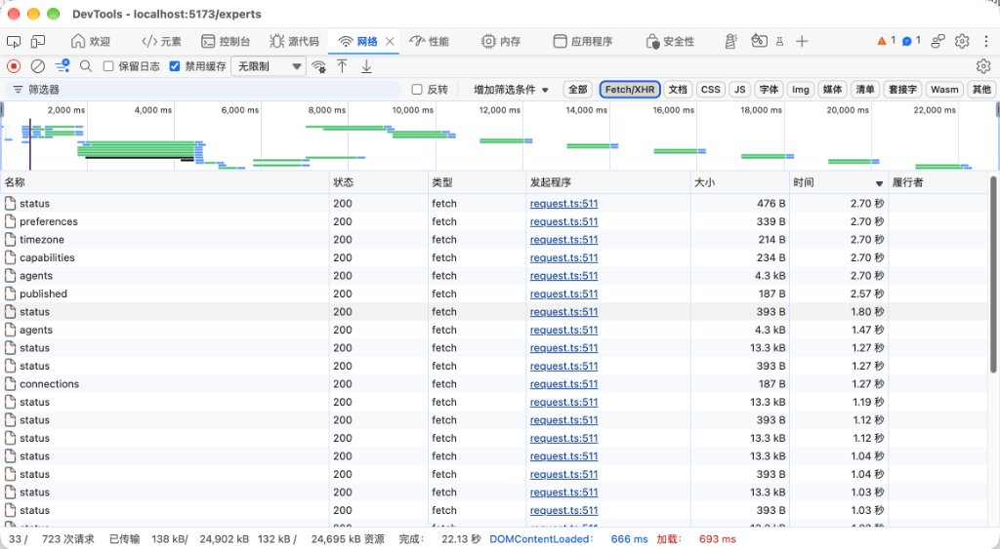
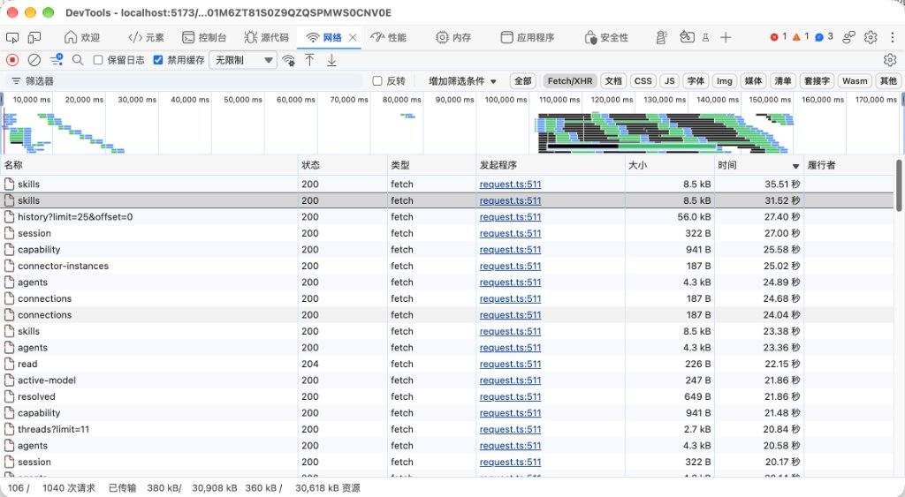
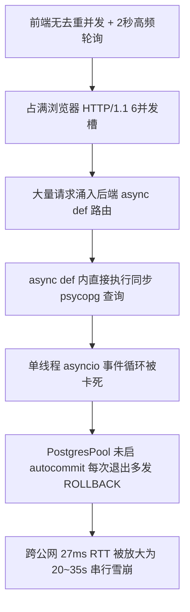

# Octop PG 模式页面慢加载与请求雪崩排查与优化记录

维护作者：`chenjixian`

基线回滚 Tag：`perf-baseline-9877fd79`

---

## 1. 现象与现场证据

本地前端（`http://localhost:5173`）连接本地后端（`127.0.0.1:8088`）直连阿里云测试服 PostgreSQL（`8.163.15.131:5432/huihuo_ai_platform`）时，打开专家列表页和专家对话详情页出现明显卡顿与大量请求排队：

### 1.1 专家列表页（`/experts`）

- 首屏多个基础请求（`status`、`preferences`、`timezone`、`capabilities`、`agents`、`published`）同时卡住 **2.70 秒**并在同一毫秒返回；
- 页面静置后持续高频轮询 `/api/agents/{id}/status`（每 ~2 秒 1 次，单次 1.0~1.8 秒）。

### 1.2 专家详情/对话页（`/agents/...`）

- 切入页面瞬间出现大量重复接口并发，形成严重队头阻塞；
- `/api/agents/MT7VPB/skills` 耗时 **35.51 秒**，`/api/agents/HQ49Y4/skills` 耗时 **31.52 秒**，`history`、`session`、`capability`、`connector-instances`、`agents`、`connections` 等普遍卡顿 **20~27 秒**。

### 1.3 HAR 实测统计（`localhost.har`）

共捕获 **1,068** 个请求，其中 **941** 个为 Vite dev mode 未打包模块文件（362 `.ts`、301 `.tsx`、92 `.less` 等，生产构建会打包合并），**127** 个为 `/api/*` 请求：

| 接口 | 次数 | 最大总耗时 | 平均浏览器排队 (`blocked`) | 平均服务端等待 (`wait`) |
| --- | ---: | ---: | ---: | ---: |
| `/api/agents/MT7VPB/skills` | 2x | 35,509 ms | 9,093 ms | 20,347 ms |
| `/api/agents/HQ49Y4/skills` | 1x | 31,525 ms | 13,289 ms | 18,233 ms |
| `/api/agents/MT7VPB/threads/.../history` | 1x | 27,407 ms | 23,255 ms | 4,149 ms |
| `/api/agents/MT7VPB/session` | 2x | 27,003 ms | 17,526 ms | 6,059 ms |
| `/api/knowledge-bases/capability` | 4x | 25,583 ms | 14,752 ms | 3,971 ms |
| `/api/connector-instances` | 4x | 25,021 ms | 13,952 ms | 3,965 ms |
| `/api/agents` | 17x | 24,886 ms | 7,006 ms | 2,536 ms |
| `/api/bridge/connections` | 17x | 24,682 ms | 4,649 ms | 1,903 ms |
| `/api/agents/MT7VPB/status` | 23x | 16,195 ms | 1,288 ms | 1,204 ms |
| `/api/agents/HQ49Y4/status` | 10x | 13,641 ms | 1,081 ms | 1,320 ms |

### 1.4 后端运行日志实证（`~/.octop/logs/octop.log`）

- 本机到阿里云 PG 的 ICMP RTT 实测均值 **26.9 ms**（同机房内网 < 0.5 ms）。
- 后端 `runtime_heartbeat` 记录：
  `total_req=405 slow_req=370 (91.4%) err_req=0 loop_lags=140 max_lag_ms=9742.18`
- 同一毫秒内多条互不相关的接口（如 `capabilities`、`preferences`、`agents` 或 `plugins`、`hitl`、`resolved`、`upload`）同时结束，证实单线程 asyncio 事件循环被同步阻塞。

---

## 2. 根因分析

1. **PG 连接池缺少 `autocommit=True` 且连接数偏小（`src/octop/infra/db/pool.py`）**
   - `psycopg_pool.ConnectionPool` 默认 `autocommit=False`，每次 `with pool.connect()` 执行单条 `SELECT` 后连接进入 `INTRANS` 状态，退出归还连接池时自动向 PG 追加一条 `ROLLBACK` 往返，导致所有单句查询的网络 RTT 翻倍。
   - 对比 `SqlitePool` 本身设置 `isolation_level=None`（autocommit 模式），两边语义未对齐；同时 `max_size=8` 在并发场景易触发连接等待。
2. **公共鉴权依赖重复查库且阻塞主事件循环（`src/octop/api/deps.py`）**
   - 每个受保护请求都经过 `async def current_user` → `async_resolve_user_from_token`，在主事件循环内同步执行多次 PG 查询（含每次请求重查几乎不变的 `secrets.jwt`）。
   - 同步 DB I/O 直接卡死单线程 asyncio 事件循环，导致并发请求退化为串行排队；同时让需要多次 `await` 让出事件循环的 `/skills` 被其他同步请求反复插队拖成 14~21 秒。
3. **无 `await` 的高频只读路由声明为 `async def`（`src/octop/api/routers/agents.py`）**
   - `list_agents` 与 `agent_status` 内部完全无 `await`，均为同步数据库查询，声明为 `async def` 会直接在事件循环主线程阻塞执行而非由 Starlette 线程池并发调度。
4. **前端高频无效轮询 + 切页重复并发（`dashboard/src/`）**
   - `useMemoryMaintenance.ts`：只要打开 Chat 页面，即使 `memory_maintenance.phase` 一直为 `idle`，仍每 `2000ms` 无限轮询 `/agents/{id}/status`。
   - `AgentCard.tsx`：专家列表页每个 `running` 状态的卡片渲染后都会每 `2000ms` 轮询 `/agents/{id}/status` 持续 15 秒。
   - `request.ts`：缺少同 URL 的 in-flight GET 请求去重，切页瞬间多个组件同时拉取同一接口（`capability` 4x、`connector-instances` 4x、`agents` 3x、`connections` 3x），迅速塞满浏览器 HTTP/1.1 同源 6 并发上限，造成后续页面核心请求在浏览器端 `blocked` 14~23 秒。

---

## 3. 安全优化实施方案

| 模块 | 文件 | 优化内容 | 安全性与兼容性保障 |
| --- | --- | --- | --- |
| PG 连接池 | `src/octop/infra/db/pool.py` | `PostgresPool` 增加 `autocommit: True`，默认 `max_size` 从 `8` 提升至 `16` | 与 `SqlitePool(isolation_level=None)` 语义对齐；`transaction()` 内的 `conn.transaction()` 在 psycopg3 中原生兼容 `autocommit=True`；全仓库已核查无依赖 `connect()` 隐式回滚的代码 |
| 公共鉴权 | `src/octop/api/deps.py` | ① `jwt` secret 增加基于 `WeakKeyDictionary` 的 30 秒进程内缓存，验签失败时自动 `force_refresh=True` 立即回源兜底；② `async_resolve_user_from_token` 中将纯同步 DB 校验（`_decode`、`_resolve_user_from_payload`）移入 `asyncio.to_thread` | 保留 `_async_require_active_session` 在当前协程执行以防 `ContextVar` 上下文丢失；支持密钥轮换与多测试实例隔离；鉴权、MFA、密码版本与会话吊销语义完全不变 |
| 高频只读路由 | `src/octop/api/routers/agents.py` | 将完全无 `await` 的 `list_agents` 与 `agent_status` 改为普通 `def` | FastAPI 自动派发到线程池并发调度，释放主事件循环；入参、权限、返回结构 100% 不变 |
| 前端请求去重 | `dashboard/src/api/request.ts` | 对无自定义 `headers` / `signal` / `body` 的纯 `GET` 请求增加按 `url + token` 隔离的 in-flight Promise 去重 | 请求结束（`finally`）立即移除，不缓存历史响应，零脏数据风险，不影响带 `AbortSignal` 的请求 |
| 前端轮询收敛 | `dashboard/src/pages/Chat/hooks/useMemoryMaintenance.ts` | 活跃维护期与断连探测期保持 `2000ms`；空闲 `idle` 期退避至 `15000ms`（标签页隐藏时 `30000ms`） | 记忆维护期间仍保持 2 秒实时刷新，兼容原有全部单元测试 |
| 前端卡片轮询 | `dashboard/src/pages/Experts/components/AgentCard.tsx` | 首次拉取 `/status` 若非维护中立即停止定时轮询，不再强制轮询 15 秒 | 正在维护中的卡片继续每 2 秒更新直到结束 |
| 其余高频只读路由 | `providers.py` / `connectors.py` / `knowledge_bases.py` / `preferences.py` / `bridge.py` | 将无 `await` 的同步只读路由（`list_resolved_models`、`get_active_model`、`list_instances`、`capability`、`get_preferences`、`list_connections`）改为普通 `def` | 由 FastAPI 线程池并发执行，彻底释放主事件循环，无缓存、零脏数据风险 |
| 消除列表 N+1 | `groups.py` / `agents.py` / `connectors.py` | `GroupAccess.visibility()` 支持 `preloaded_group_ids`；`list_agents` 与 `list_instances` 改用 `group_ids_by_resource()` 单次批量查询并复用内存用户缓存 | 纯 SQL 合并，100% 实时强一致，完全向后兼容原签名 |

---

## 4. 验证记录

- **前端单测与类型检查**：
  - `npx vitest run src/pages/Chat/hooks/useMemoryMaintenance.test.ts`：6/6 通过。
  - `npx tsc --noEmit`：0 错误通过。
- **后端编译与签名检查**：
  - `pool.py`、`deps.py`、`agents.py` 编译通过，`list_agents` 与 `agent_status` 确认为同步函数。
- **重启后实测对比（同一本机 + 阿里云 PG 环境）**：

| 指标 | 优化前 | 优化后 |
| --- | --- | --- |
| `runtime_heartbeat` 慢请求占比 (`slow_req / total_req`) | 370 / 405（91.4%） | **0 / 52（0.0%）** |
| 运行期新增事件循环卡顿 (`loop_lags`) | 持续增长至 140 次 | **运行期新增 0 次**（仅启动期 19 次） |
| 最大事件循环延迟 (`max_lag_ms`) | 9,742 ms | **3,346 ms**（仅启动期） |
| 后端 RSS 内存 | 550.3 MB | **369.5 MB** |
| 代理探活 `/api/auth/youli/status` | — | **19.7 ms**（HTTP 200） |

- **回滚方式**：
  - 如需回退到优化前状态，可直接切回基线 Tag：`git checkout perf-baseline-9877fd79`。
